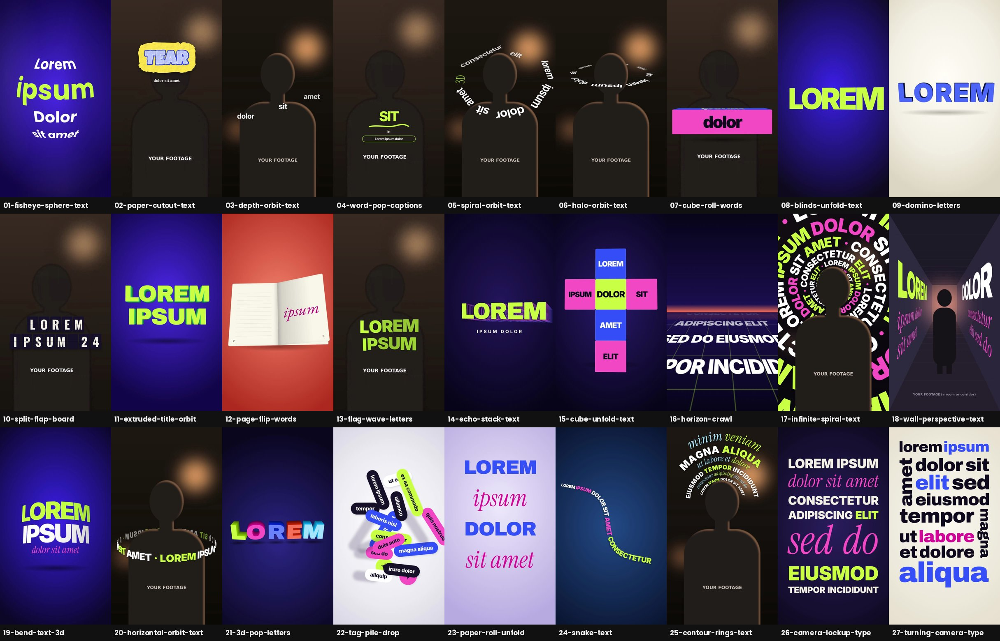

# claude-text-effects

27 vertical (9:16) kinetic text effects, inspired by reference reels and tutorials and rebuilt as editable [HyperFrames](https://hyperframes.heygen.com) templates (HTML + GSAP → MP4). Packaged as a Claude Code plugin: apply a style with `/video-style <style> <brief>`. Each style's shortcut is in the table below; the number works too (`/video-style 24`).



| # | Style | Shortcut | Best for | Footage |
|---|---|---|---|---|
| 01 | [Fisheye Sphere Text](styles/01-fisheye-sphere-text/STYLE.md) | `/video-style fisheye-sphere-text` | Hook titles on a fisheye sphere that snap-rolls line by line; gliding fisheye lens | — |
| 02 | [Paper Cut-out Text](styles/02-paper-cutout-text/STYLE.md) | `/video-style paper-cutout-text` | Bubble letters on torn paper: flutter / tear / stamp in, 12 fps stop motion | ✔ |
| 03 | [Depth & Orbit Text](styles/03-depth-orbit-text/STYLE.md) | `/video-style depth-orbit-text` | Words peek from behind the subject, helix climb, rising giant letters, depth tunnel | ✔ |
| 04 | [Word-Pop Captions](styles/04-word-pop-captions/STYLE.md) | `/video-style word-pop-captions` | Rolling one-word captions, marker underlines, cursor select, circle-reveal cards | ✔ |
| 05 | [Spiral Orbit Text](styles/05-spiral-orbit-text/STYLE.md) | `/video-style spiral-orbit-text` | A sentence sliding along a 3D spiral round the speaker's head, dive-through exit | ✔ |
| 06 | [Halo Orbit Text](styles/06-halo-orbit-text/STYLE.md) | `/video-style halo-orbit-text` | One line of words orbiting the speaker's head as a tilted halo | ✔ |
| 07 | [Cube Roll Words](styles/07-cube-roll-words/STYLE.md) | `/video-style cube-roll-words` | Words on the faces of a 3D bar that tumbles in and rolls one face per beat | ✔ |
| 08 | [Blinds Unfold Text](styles/08-blinds-unfold-text/STYLE.md) | `/video-style blinds-unfold-text` | Giant words cut into slats that swing open like venetian blinds | — |
| 09 | [Domino Letters](styles/09-domino-letters/STYLE.md) | `/video-style domino-letters` | Thick extruded letters stand up like dominoes, then topple | — |
| 10 | [Split-Flap Board](styles/10-split-flap-board/STYLE.md) | `/video-style split-flap-board` | Departure-board tiles flip through letters into place | ✔ |
| 11 | [Extruded Title Orbit](styles/11-extruded-title-orbit/STYLE.md) | `/video-style extruded-title-orbit` | Thick 3D block title; camera orbits, snaps face-on with a glare | — |
| 12 | [Page Flip Words](styles/12-page-flip-words/STYLE.md) | `/video-style page-flip-words` | One word per page of an open book; pages turn on the spine | — |
| 13 | [Flag Wave Letters](styles/13-flag-wave-letters/STYLE.md) | `/video-style flag-wave-letters` | Letters ripple like a flag, then a gust blows them away | ✔ |
| 14 | [Echo Stack Text](styles/14-echo-stack-text/STYLE.md) | `/video-style echo-stack-text` | A deep trail of outline echoes that collapse into one solid word | — |
| 15 | [Cube Unfold Text](styles/15-cube-unfold-text/STYLE.md) | `/video-style cube-unfold-text` | A word on every face of a cube that unfolds flat into a cross | — |
| 16 | [Horizon Crawl](styles/16-horizon-crawl/STYLE.md) | `/video-style horizon-crawl` | Lines glide away over a neon grid floor; the hero word stands up | — |
| 17 | [Infinite Spiral Text](styles/17-infinite-spiral-text/STYLE.md) | `/video-style infinite-spiral-text` | A phrase streaming endlessly out of a spiral that fills the background | ✔ |
| 18 | [Wall Perspective Text](styles/18-wall-perspective-text/STYLE.md) | `/video-style wall-perspective-text` | Words painted on the side walls of a room, following their perspective | ✔ |
| 19 | [Bend Text 3D](styles/19-bend-text-3d/STYLE.md) | `/video-style bend-text-3d` | A headline on a flexible sheet that bends, rolls into a tube and springs flat | — |
| 20 | [Horizontal Orbit Text](styles/20-horizontal-orbit-text/STYLE.md) | `/video-style horizontal-orbit-text` | Upright letters on a horizontal ring orbiting the speaker like a carousel | ✔ |
| 21 | [3D Pop Letters](styles/21-3d-pop-letters/STYLE.md) | `/video-style 3d-pop-letters` | A flat word pops up into candy-coloured 3D blocks, spin-waves, sinks flat | — |
| 22 | [Tag Pile Drop](styles/22-tag-pile-drop/STYLE.md) | `/video-style tag-pile-drop` | Pill tags drop onto a table one by one into a heap, then fly back up | — |
| 23 | [Paper Roll Unfold](styles/23-paper-roll-unfold/STYLE.md) | `/video-style paper-roll-unfold` | The words themselves roll up like a paper roll and unroll top to bottom | — |
| 24 | [Snake Text](styles/24-snake-text/STYLE.md) | `/video-style snake-text` | A sentence slithering diagonally in the shape of a snake, last word as the head | — |
| 25 | [Contour Rings Text](styles/25-contour-rings-text/STYLE.md) | `/video-style contour-rings-text` | Lines of text nesting round the speaker's head like contour lines | ✔ |
| 26 | [Camera Lockup Type](styles/26-camera-lockup-type/STYLE.md) | `/video-style camera-lockup-type` | Words flip in to build a justified block while the camera frames each one | — |
| 27 | [Turning Camera Type](styles/27-turning-camera-type/STYLE.md) | `/video-style turning-camera-type` | A flush word puzzle with sideways words; the camera turns 90° to read each one | — |

Each style folder has `STYLE.md` (the spec), `template/` (the HyperFrames project), `preview.mp4` and `poster.jpg`.

## Use it

**As a plugin (Claude Code):**
```bash
/plugin marketplace add mjcamelobrito-ux/claude-text-effects   # or install from a local path
/video-style contour-rings-text "my clip: assets/talk.mp4"
```

**By hand:**
```bash
npm i -g hyperframes            # needs Node 18+, ffmpeg
cp -r styles/25-contour-rings-text/template my-clip
cp ~/footage/ep12.mp4 my-clip/assets/            # then set footageSrc in scenes.json
# edit copy in my-clip/compositions/*.html, timing in scenes.json
python3 tools/build_index.py my-clip
cd my-clip && npx hyperframes preview            # live editor
npx hyperframes check && npx hyperframes render -o ep12.mp4
```

## How a template is built

- `scenes.json` — scene order, durations, editable variables (brand colours), optional talking-head footage layer. `tools/build_index.py` turns it into `index.html`.
- `compositions/<scene>.html` — one scene per file, everything on a paused GSAP timeline (deterministic, frame-accurate). Captions and hard cuts use `tl.set` so seeking is exact.
- `assets/` — neutral placeholders (silhouette footage and subject cut-out) and the OFL Google fonts each style needs (e.g. Instrument Serif, Luckiest Guy, Lora, Inter Tight).

## Notes

- All on-screen text is **lorem ipsum** placeholder, sized like the original copy. `/video-style` replaces it with lines from your script or the transcript of the footage you give it.

- Reference videos are **not** included (they belong to their creators); each STYLE.md names its source.
- Placeholder art is intentionally plain; the style comes from type, colour, layout and timing. Swap in real cut-outs, footage and logos you have rights to.
- "Text behind the person" styles (03, 05, 06, 17, 20, 25) have a subject cut-out layer wired in (`cutoutSrc`); swap in a cut-out of your own speaker.
