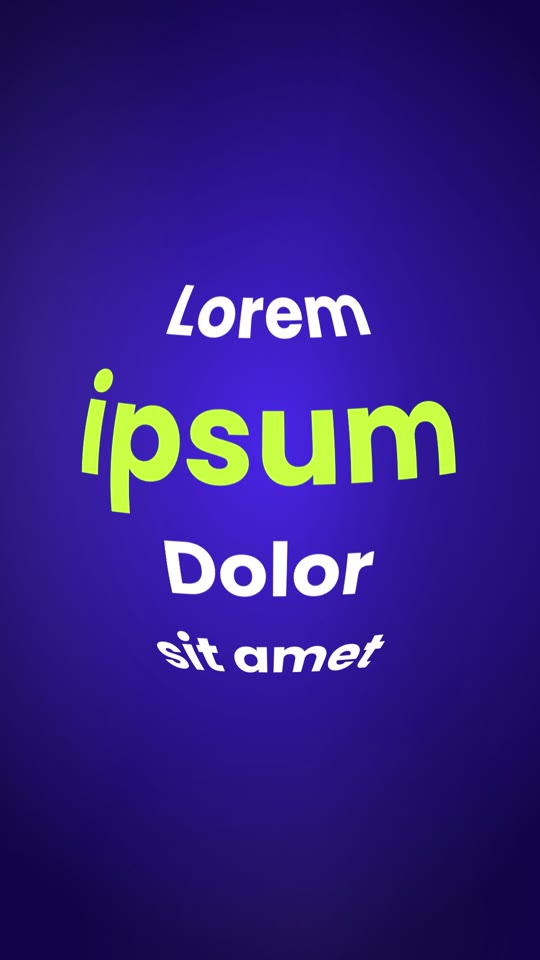

# 01 · Fisheye Sphere Text

**Inspired by:** "Day 57 of teaching After Effects Basics" (fisheye / CC Sphere text). The fisheye type is borrowed; the motion is new.
**Best for:** Hooks and title cards that need one punchy phrase to feel tactile: course intros, "this is the X effect" posts, product names, list openers.
**Format:** 1080×1920 (9:16), 30 fps · demo length 10.6 s · footage: No (solid colour stage).

  ·  [preview.mp4](preview.mp4)

## Look
- A block of words wrapped onto an invisible sphere: only the type shows, bulging in the middle and squeezing toward the rim (After Effects: pre-comp → CC Sphere / Optics Compensation "fisheye").
- `fe1`: four lines stacked on the sphere, the second line is the accent hero. `fe2`: a flat three-line paragraph with a glass fisheye lens over it.
- Rounded heavy sans (Poppins 800); hero word in electric lime `#c8ff3c`, the rest white (reference used cyan on crimson).
- Background: cobalt-violet radial gradient (`#4b34f0` → `#120a4a`) with soft, slowly drifting cloth folds.

## Motion language
- **Vertical lens roll (`fe1`):** the sphere rolls *down* through the lines one at a time and lands on each with a small overshoot ("snap"), drifting a few degrees sideways per line so the letters slide round the curve. Each landing gives a quick lens pulse (scale 1.07 → 1). It ends by rolling back to the hero and spinning out sideways while shrinking to a dot.
- **Gliding magnifier (`fe2`):** a round fisheye lens with a glass rim glides over a dimmed paragraph along the reading path (line 1 left→right, sweep down, back-out landing on the hero word, swell), then opens over the whole frame.
- Motion blur on the sphere comes from averaging 16 renders across the shutter.

## Edit rhythm
One line per ~1 s (0.45 s roll + hold); the lens reads one line per second.

## Scene recipe
| Scene file | What it does |
| --- | --- |
| `compositions/fe1.html` | Four lines on a sphere: vertical snap-roll line by line, lens pulses, spin-out. |
| `compositions/fe2.html` | Fisheye lens glides over a flat paragraph, rests on the hero word, opens up. |

## What to swap
- Words: the hidden `<span class="fe1-copy">` / `fe2-copy` elements in each scene (painted when the scene loads). In `fe2`, the `hero` span names the word drawn in the accent colour.
- Colours: `accent` (hero word), `ink` (other words), `bgLight`, `bgDeep`.
- Roll: the `KEYS` array in `fe1` (`[time, longitude°, latitude°, "snap" | "linear"]`), line sizes/latitudes in `rows`. Lens path, radius and magnification: the `st` tweens in `fe2`.
- Sphere size/position: `#fe1-wrap` box (canvas is square; radius = half its width).

## How it works
The words are drawn into an equirectangular "plate" canvas (4096×2048, 11.4 px per degree); a WebGL shader maps the plate onto an orthographic sphere and rotates it by the camera's longitude/latitude. Drawing is driven from the scene's GSAP timeline (`onUpdate`), so every frame is deterministic. Needs WebGL (headless Chrome uses SwiftShader; it works, just renders a little slower).

## Build / render
```bash
cd styles/01-fisheye-sphere-text/template
python3 ../../../tools/build_index.py .
npx hyperframes preview
npx hyperframes check
npx hyperframes render -o out.mp4
```
