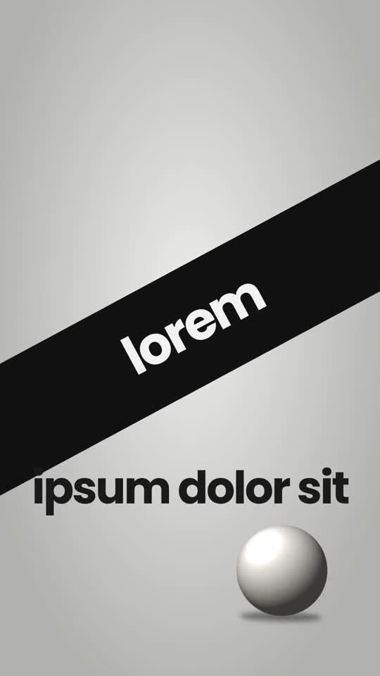

# 01 · Kinetic Type Collage

**Reference:** "Editing is like cooking…" (motion-graphics reel, 15 s)
**Best for:** Metaphor-driven brand or creator stories told entirely in type: no presenter needed. Good for manifesto posts, hooks for service pages, motivational carousels turned into video.
**Format:** 1080×1920 (9:16), 30 fps · demo length 10.8 s · footage: No: pure motion graphics.

  ·  [preview.mp4](preview.mp4)

## Look
- Solid colour fields that switch per scene: light grey `#d8d8d5`, deep green `#1f6e50`, near-black `#121212`; teal glow `#3fc1aa` as the only accent.
- Type mixes three voices in one stack: heavy rounded sans (Poppins 700) for most words, a bold serif (Playfair Display) for the emotional word, and wide-tracked thin caps (Oswald) for the closing title.
- Hierarchy by size jumps, not weight: a 70 px word sits on top of a 210 px word.
- Cut-out 3D props (salt shakers, plates in the reference) tumble in around the words; flat silhouette illustrations with a teal rim light in the dark scenes.
- Highlight bar wipes behind one serif word; a thin white strike-line crosses out a key word.

## Motion language
- Every word lands on a beat with `back.out` overshoot plus a short blur-in (0.25–0.35 s).
- Scene changes are whip-pans: everything blurs out to the left in 0.2 s and the next colour field whips in from the right.
- Props fall with `bounce.out` and keep a slow float afterwards.
- Ending: screen clears, wide-tracked title flickers on like a neon tube and slowly scales up.

## Edit rhythm
New beat every 0.25–0.4 s, new colour field every 2–2.6 s. Total 10–15 s.

## Scene recipe
All on-screen copy is lorem-ipsum placeholder sized like the reference; quotes below describe what each slot held in the reference reel. Replace it with lines from your script or the footage transcript, keeping roughly the same word count per slot.

| Scene file | What it does |
| --- | --- |
| `compositions/kc1.html` | Diagonal black band sweeps in carrying the first word; second line pops; prop slides in; whip-out. |
| `compositions/kc2.html` | Green field: small lead line + giant key word, strike-line, props tumble in. |
| `compositions/kc3.html` | Word-per-beat stack (but / if / you / KEEP / making) with highlight bar; zoom-blur exit. |
| `compositions/kc4.html` | Dark field, silhouette illustration + glow, closing wide-tracked title flicker. |

## What to swap
- Colours: `accent`, `glow` variables.
- Props: replace `assets/object-sphere.png` with transparent PNG cut-outs (keep ~900 px square).
- Silhouette: replace the inline SVG in `kc4.html` with your illustration.
- Editable variables (HyperFrames Variables panel): `accent`, `glow`.

## Build / render
```bash
cd styles/01-kinetic-type-collage/template
python3 ../../../tools/build_index.py .   # after reordering/retiming scenes.json
npx hyperframes preview                    # live preview / edit
npx hyperframes check                      # lint + layout audit
npx hyperframes render -o out.mp4          # final render
```
