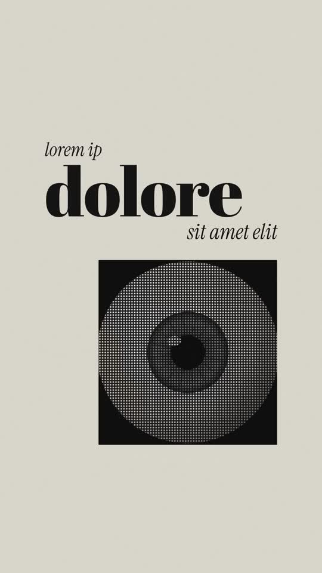

# 02 · Editorial Halftone

**Reference:** "Only your final edit will matter in the end" (7.6 s, After Effects)
**Best for:** Short, quote-like reels with a magazine feel: personal brand statements, studio intros, signature/outro cards.
**Format:** 1080×1920 (9:16), 30 fps · demo length 10 s · footage: No: pure motion graphics.

  ·  [preview.mp4](preview.mp4)

## Look
- Warm paper ground `#e3ded3` with subtle grain; pure black ink.
- Didone display serif (Abril Fatface) for the hero word, italic serif (Instrument Serif) for connective words, a geometric sans (Poppins 700) only for the glitch beat, and a calligraphic script (Mrs Saint Delafield) for the sign-off.
- One image motif repeated: a halftone-dotted object (eyeball in the reference) inside a black card, then as huge cropped circles bleeding off the corners.
- A graphic replaces a letter (sun icon instead of the R in WORDS).
- Tiny rotated body copy along the card edge = editorial detail.

## Motion language
- Letters of the hero word rise one by one (stagger 0.05 s).
- A small black square grows into the image card (`expo.inOut`).
- Halftone circles zoom in from the corners with slight parallax drift.
- Glitch beat: stepped RGB-split copies, coloured slice bars and skew jolts (no tweening between states), then smash to blank paper.
- Handwritten sign-off reveals left-to-right, logo mark pops.

## Edit rhythm
Slow and deliberate (2.5 s per idea) with one violent 1 s glitch before the ending.

## Scene recipe
All on-screen copy is lorem-ipsum placeholder sized like the reference; quotes below describe what each slot held in the reference reel. Replace it with lines from your script or the footage transcript, keeping roughly the same word count per slot.

| Scene file | What it does |
| --- | --- |
| `compositions/eh1.html` | 'the way / PEOPLE / judge your work' + halftone card growing from a square. |
| `compositions/eh2.html` | 'speaks / louder than their / WO☀DS' with corner halftone eyes. |
| `compositions/eh3.html` | 'won't / matter' RGB-split glitch. |
| `compositions/eh4.html` | Script sign-off + logo mark + handle. |

## What to swap
- `assets/eye.svg` is a drawn placeholder: any B&W photo works; the `.eh-dots` overlay does the halftone.
- Colours: `ink`, `paperTone`.
- Sign-off text and handle in `eh4.html`; replace the leaf SVG with your logo.
- Editable variables (HyperFrames Variables panel): `ink`, `paperTone`.

## Build / render
```bash
cd styles/02-editorial-halftone/template
python3 ../../../tools/build_index.py .   # after reordering/retiming scenes.json
npx hyperframes preview                    # live preview / edit
npx hyperframes check                      # lint + layout audit
npx hyperframes render -o out.mp4          # final render
```
