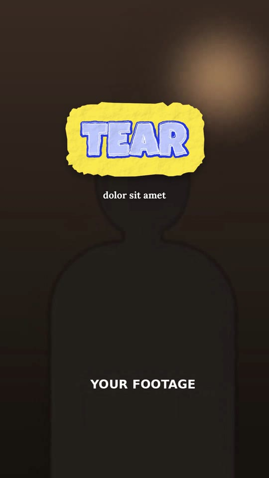

# 02 · Paper Cut-out Text

**Inspired by:** "How to create paper text effects — regular text is boring". The paper cut-out look and 12 fps stop-motion are borrowed; the entrances and exits are new.
**Best for:** Playful, handmade creator content: lifestyle, crafts, kids/pets brands, personal vlogs, anything that should feel un-templated.
**Format:** 1080×1920 (9:16), 30 fps · demo length 11.8 s · footage: Yes: a talking-head video plays under every scene (`footageSrc`).

  ·  [preview.mp4](preview.mp4)

## Look
- Words in hand-drawn bubble letters (Luckiest Guy, wobbled with a displacement filter): pale fill, thick darker outline of the same hue, thin white highlight.
- Each word sits on a torn paper cut-out (rough superellipse with scissor notches), real paper grain and wrinkles (fractal noise + diffuse lighting), soft drop shadow.
- Colour pairs (bold & fresh): orange on mint/lilac (title stack), cobalt on hot yellow (TEAR), green on pink (FLUTTER), magenta on sky blue (STAMP).
- Small bold serif caption (Lora) under the card, white with a soft shadow.

## Motion language
Everything moves at **12 fps stop-motion** (each change holds 2 video frames).
- **Flutter in:** the card drops from above like a leaf, swinging side to side and tipping in 3D, then lands with a squash.
- **Tear in / out:** two torn halves (jagged seam) slide in from both sides and seal with a jolt; on exit they rip apart up and down.
- **Stamp in:** slams down from above the lens in 3 frames, wrinkles pop deep on impact and relax, the frame shakes.
- **Wind out:** a gust takes the card off frame to the right, tumbling and accelerating.
- **Boil:** while held, the card twitches a hair every 2 frames, as if re-placed by hand.

## Edit rhythm
Entrance 0.6–1 s, hold ~1.3 s, exit 0.5 s. One card per idea; the 3-card title stack drops 0.3 s apart.

## Scene recipe
| Scene file | What it does |
| --- | --- |
| `compositions/pc1.html` | 3-card title stack: flutter down one by one, boil, blown away. |
| `compositions/pc2.html` | TEAR in/out + caption (`data-shards="2"`). |
| `compositions/pc3.html` | FLUTTER in, wind out + caption. |
| `compositions/pc4.html` | STAMP in with frame shake, wind out + caption. |

## What to swap
- Word: the `.pc-word` span inside each `.pc-card` (the card resizes to fit).
- Per-card look: `data-size` (letter size px), `data-ink`, `data-ink-dark`, `data-paper`, `data-seed` (changes the tear shape and wrinkles).
- Effect per card: `flutterIn`, `tearIn` / `tearOut` (needs `data-shards="2"`), `stampIn` (+ `shake` on the stage), `windOut`.
- Footage: `footageSrc`. Caption colour: `caption`.
- Want the real thing? Photograph your own handwritten paper cut-outs and swap them in: the 12 fps timing helpers still apply.

## Build / render
```bash
cd styles/02-paper-cutout-text/template
python3 ../../../tools/build_index.py .
npx hyperframes preview
npx hyperframes check
npx hyperframes render -o out.mp4
```
