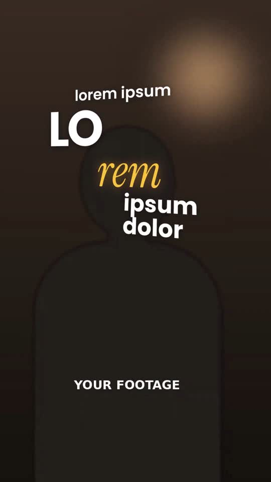

# 03 · Creator Tool Promo

**Reference:** "POV: you edit an entire video by typing one sentence" (Cardboard) and "I LOVE editing my own videos but…" (Submagic)
**Best for:** Talking-head product/tool demos, SaaS promos, affiliate content, any 'here's how I do X' reel with UI screens.
**Format:** 1080×1920 (9:16), 30 fps · demo length 11.6 s · footage: Yes: a talking-head video plays under every scene (`footageSrc`).

  ·  [preview.mp4](preview.mp4)

## Look
- Real footage, warm cinematic grade, shallow depth of field.
- Hook words are big, 3D-tilted and glowing, mixing bold sans with an italic serif in a warm accent (`#ffc23d`).
- Running subtitles are small (≈46 px), centred in the lower third, white with ONE keyword per line in the accent colour.
- Split layout for demos: product UI card drops over the top half on a light panel; the speaker stays visible underneath; brand badge in the corner.
- CTA: 'comment' italic serif + huge condensed keyword (Anton) with orange glow.

## Motion language
- Hook words swing in on X/Y axes from depth (`back.out`), whole stack drifts.
- Caption groups hard-swap on the beat (no fades) with a 0.12 s scale pop.
- Giant emphasis words zoom-punch over the speaker for 0.7 s, then vanish.
- UI card drops like a sheet, scrolls slowly (screen-recording feel), cursor glides and clicks, ring pulse + card punch-in.

## Edit rhythm
Hook < 2 s; captions change every 0.8–1 s; one UI demo beat per 3–4 s; CTA holds ≥ 2 s.

## Scene recipe
All on-screen copy is lorem-ipsum placeholder sized like the reference; quotes below describe what each slot held in the reference reel. Replace it with lines from your script or the footage transcript, keeping roughly the same word count per slot.

| Scene file | What it does |
| --- | --- |
| `compositions/ct1.html` | 3D kinetic hook stack over the speaker. |
| `compositions/ct2.html` | Small captions + giant emphasis words. |
| `compositions/ct3.html` | Split-screen UI demo with cursor click and badge. |
| `compositions/ct4.html` | Comment-keyword CTA. |

## What to swap
- Footage: drop your clip in `assets/` and set `footageSrc` (or replace `speaker-warm.mp4`).
- UI: replace `assets/ui-screen.png` with your screenshot (900 px wide) or a screen recording.
- Colours: `accent`, `brand`.
- For true text-behind-person, export a subject matte (rotoscope) and layer it above `ct2-big`.
- Editable variables (HyperFrames Variables panel): `accent`, `brand`.

## Build / render
```bash
cd styles/03-creator-tool-promo/template
python3 ../../../tools/build_index.py .   # after reordering/retiming scenes.json
npx hyperframes preview                    # live preview / edit
npx hyperframes check                      # lint + layout audit
npx hyperframes render -o out.mp4          # final render
```
