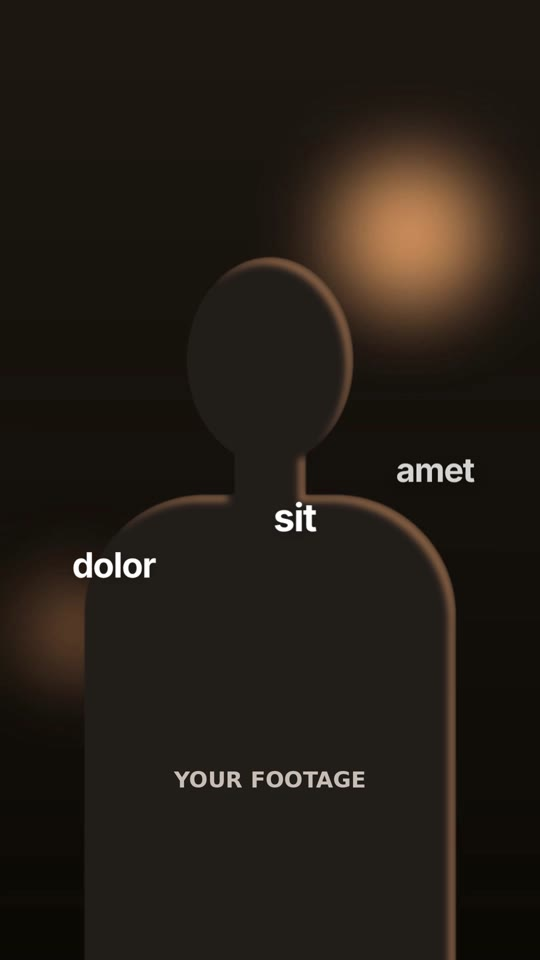

# 03 · Depth & Orbit Text

**Inspired by:** "How to do the 3D text effect… straight sauce ep 1". Text living in depth around the subject is borrowed; the motion is new.
**Best for:** Moody talking-head reels where captions should live *in the room*: personal brand, tutorials, storytelling hooks.
**Format:** 1080×1920 (9:16), 30 fps · demo length 11.4 s · footage: Yes (`footageSrc`) **plus a subject cut-out** (`cutoutSrc`) layered between back and front text.

  ·  [preview.mp4](preview.mp4)

## Look
- Two type voices only: heavy tight grotesk (Inter 900, −0.055em) and elegant italic serif (Instrument Serif Italic); medium sans (Inter 700) for small words. White with a soft shadow; serif words in coral `#ff7a59` (`accent`).
- Words hung at different depths around the subject; some pass **behind** the head/body.
- Giant grotesk words fill the frame behind the subject, smaller sans/serif words in front.
- Warm, dark, low-key footage.

## Motion language
- **Peek-out:** small words start hidden behind the head and slide out to either side; the hero serif word rises out from behind the head and settles above it. To exit, everything slips back behind the subject.
- **Helix climb:** words sit on a spiral around the body (80° and 95 px apart); the spiral turns and climbs, words appear bottom-up, the far side passes behind the subject and is smaller and dimmer.
- **Rising letters:** giant grotesk words build letter by letter, rising from below the frame behind the subject with an overshoot; to swap, the letters fall away in order and the next word rises. Front lines type on character by character; the serif + sans pair meets from above and below.
- **Depth tunnel:** words rush out of the distance at the lens and blow past it (big, blurred, gone); the last word stops at the screen plane.
- **Underline caption:** a lime bar slides from word to word under the caption as each is spoken.

## Edit rhythm
Beats ~1.1 s for giant words; small words pop every 0.2 s; scenes 2.4–3.4 s.

## Scene recipe
| Scene file | What it does |
| --- | --- |
| `compositions/dt1.html` | Peek-out: words slide from behind the head; hero rises from behind it. |
| `compositions/dt2.html` | Helix of 9 words climbing and turning around the subject. |
| `compositions/dt3.html` | Giant words rise letter by letter behind the subject; typed front line; serif+sans pair. |
| `compositions/dt4.html` | Depth tunnel words + sliding-underline caption. |

## What to swap
- Footage: `footageSrc`.
- **Cut-out (`cutoutSrc`)**: the text-behind effect needs your subject isolated on transparency, aligned to the footage. A still PNG works for a locked-off shot; for movement, export a matte video with alpha (WebM VP9 or ProRes 4444 → WebM) and replace the `` in each scene with `<video class="clip dt-cut" data-start="0" data-duration="…" muted src="assets/subject.webm">`. Tools: CapCut/Premiere "remove background", After Effects Roto Brush, or `rembg`/`backgroundremover` on the frames.
- Helix words: the `dt2-b*` / `dt2-f*` pairs (keep both copies identical); radius, spacing and start: `R`, `STEP`, `Y0`. Giant words: one `<span class="L">` per letter.
- Colours: `ink` (white type), `accent` (serif words), `hi` (caption highlight).

## Build / render
```bash
cd styles/03-depth-orbit-text/template
python3 ../../../tools/build_index.py .
npx hyperframes preview
npx hyperframes check
npx hyperframes render -o out.mp4
```
