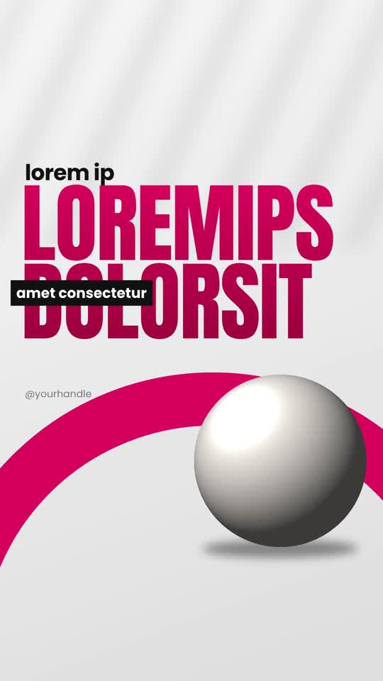

# 04 · Poster Motion

**Reference:** "Why 99% of people will never escape the 9-5" and "Here's the branding secrets no one tells you" (same creator)
**Best for:** Opinion/tips reels, carousel-to-video, brand-strategy content. Reads like an animated poster series.
**Format:** 1080×1920 (9:16), 30 fps · demo length 11.6 s · footage: No: pure motion graphics.

  ·  [preview.mp4](preview.mp4)

## Look
- Soft light-grey gradient with diagonal window-light streaks.
- Huge condensed headline (Anton) with a vertical gradient in one accent colour; pink `#e5195e` preset or orange `#ef8f2b` preset.
- A thick accent swoosh ring cropped off-frame.
- Black label tag with white text ('no one tells you') tucked under the headline.
- Hero 3D cut-out object overlapping the headline (megaphone, statue, chess pieces in the references).
- Huge blurred ghost copy of the line in the background; 4-point sparkle stars in the accent; one dark contrast beat.

## Motion language
- Frame 0 is already a finished poster (thumbnail), then elements settle.
- Blur-push transitions between posters (blur 24 px + opacity + slight move).
- Greyed keyword fills to ink on the beat ('pacing').
- Lists build one item per beat with soft blur-in; headline wipes in with a clip reveal.

## Edit rhythm
One poster per 2–2.6 s; one 1 s contrast beat on black; total 8–12 s.

## Scene recipe
All on-screen copy is lorem-ipsum placeholder sized like the reference; quotes below describe what each slot held in the reference reel. Replace it with lines from your script or the footage transcript, keeping roughly the same word count per slot.

| Scene file | What it does |
| --- | --- |
| `compositions/pm1.html` | Hero poster: lead line + gradient headline + tag + object + swoosh. |
| `compositions/pm2.html` | Statement with keyword fill and ghost text. |
| `compositions/pm3.html` | Dark contrast beat with sparkles. |
| `compositions/pm4.html` | Calm italic list. |
| `compositions/pm5.html` | Closing headline over grid with object and stars. |

## What to swap
- `accent` / `accentDeep` for the colourway (orange preset: `#ef8f2b` / `#b85d12`).
- `assets/object-sphere.png` → your 3D cut-outs.
- Handle text in pm1/pm5.
- Editable variables (HyperFrames Variables panel): `accent`, `accentDeep`.

## Build / render
```bash
cd styles/04-poster-motion/template
python3 ../../../tools/build_index.py .   # after reordering/retiming scenes.json
npx hyperframes preview                    # live preview / edit
npx hyperframes check                      # lint + layout audit
npx hyperframes render -o out.mp4          # final render
```
