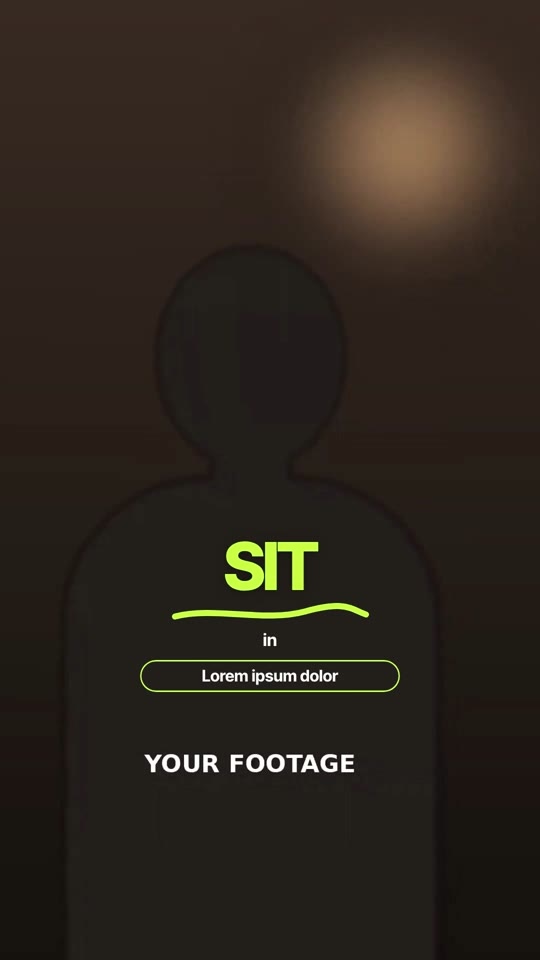

# 04 · Word-Pop Captions

**Inspired by:** "My workflow for using AI in my videos — comment 'Magic' for full guide". One-word captions and keyword treatments are borrowed; the motion is new.
**Best for:** Fast talking-head explainers, AI/tool workflows, "step one / step two" tutorials, any reel where every word should hit.
**Format:** 1080×1920 (9:16), 30 fps · demo length 11.4 s · footage: Yes (`footageSrc`); the studio scene uses a subject cut-out (`cutoutSrc`).

  ·  [preview.mp4](preview.mp4)

## Look
- **One word on screen at a time**, centred, big (132 px) tight sans (Inter Tight 700, −0.045em), soft shadow.
- Colour per scene: white on footage, electric lime `#c8ff3c` keywords, cobalt `#2f55ff` on cards and bright scenes, warm cream studio.
- Accents: lime keyword with a hand-drawn **marker underline**; design-tool **selection frame** + **cursor**; outline **pill**; a **label over a counting value**; a fat **marker stroke** behind black text.
- Full-frame **chapter cards**: black then cobalt, one word each ("step" / "one").
- Bright studio scene: giant cobalt words standing **behind** the subject cut-out, tiny stacked lead-in words.

## Motion language
- **Rolling ticker:** each word rolls up into a masked caption line and the previous one rolls out the top (0.16 s, power3).
- **Marker draw:** underlines and highlighter strokes draw themselves on (SVG stroke), like a hand with a marker.
- **Cursor select:** a cursor glides in and clicks the word; the selection frame grows from the click point, handles pop, the word turns lime.
- **Circle reveals:** chapter cards open as circles, from the centre, then from the bottom-right corner.
- **Gravity letters:** in the studio scene, giant letters fall from above with a bounce behind the subject and sink through the floor to exit.
- **Count-up:** the value under the label counts up from 0 while the label slides in.

## Edit rhythm
A word every 0.3–0.5 s (the speaker's pace); keywords hold ~1 s; chapter cards 0.7–0.9 s.

## Scene recipe
| Scene file | What it does |
| --- | --- |
| `compositions/wp1.html` | Rolling words + lime keyword, marker underline, typed label, pill growing from a dot. |
| `compositions/wp2.html` | Cursor clicks a word; selection frame grows; more rolling words. |
| `compositions/wp3.html` | Chapter cards opening as circles, one word each. |
| `compositions/wp4.html` | Studio: giant letters drop with a bounce behind the subject cut-out. |
| `compositions/wp5.html` | Lime keyword, counting value under a label, marker stroke behind black text. |

## What to swap
- Words: one `.cw` per word inside a `.line` mask; timing is `roll(selector, start, end)`. With footage, transcribe it and set each word's start/end from the word timestamps.
- Colours: `highlight`, `accent`, `studio`. Cut-out: `cutoutSrc`.
- Selection frame: `#wp2-box` size/position to wrap the chosen word; cursor path in the `#wp2-cur` tweens. Giant studio words: one `<span class="L">` per letter.

## Build / render
```bash
cd styles/04-word-pop-captions/template
python3 ../../../tools/build_index.py .
npx hyperframes preview
npx hyperframes check
npx hyperframes render -o out.mp4
```
