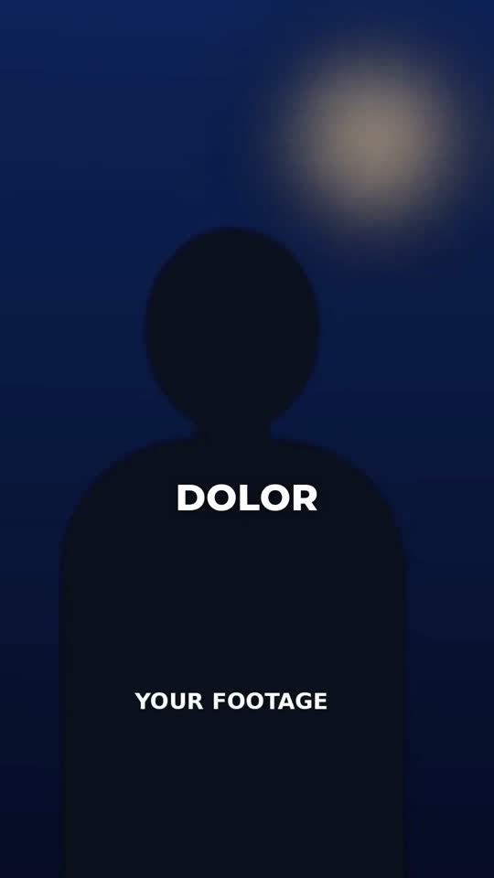

# 06 · Step-by-Step Studio

**Reference:** "How to find video editors"
**Best for:** How-to / listicle talking heads (Step 1, Step 2…), recruiting, tutorials that show web flows.
**Format:** 1080×1920 (9:16), 30 fps · demo length 12.2 s · footage: Yes: a talking-head video plays under every scene (`footageSrc`).

  ·  [preview.mp4](preview.mp4)

## Look
- Talking head in a blue-lit studio with a warm practical lamp.
- Single uppercase bold word captions (Montserrat 800) at chest height.
- STEP titles in a blue gradient with glow and a light streak.
- Clean white UI mockups: search bar typing, list with a blue header block and black Follow pills, DM bubbles.
- CTA: small tracked 'COMMENT' + big gradient keyword in quotes.

## Motion language
- Word captions swap per stressed word with `back.out(3)` pop.
- Step title ignites from a horizontal lens streak (scaleY 0.05 → 1) with a light sweep.
- Search text types in steps; rows slide in staggered; slow push on the list.
- Chat bubbles pop like a live conversation.
- VHS smear transition: stretched light slices + stepped horizontal jolts.

## Edit rhythm
Captions every 0.4–0.5 s; a step title every ~6–8 s; screens 2.5–3 s each.

## Scene recipe
All on-screen copy is lorem-ipsum placeholder sized like the reference; quotes below describe what each slot held in the reference reel. Replace it with lines from your script or the footage transcript, keeping roughly the same word count per slot.

| Scene file | What it does |
| --- | --- |
| `compositions/st1.html` | Uppercase word captions. |
| `compositions/st2.html` | STEP ONE title ignite. |
| `compositions/st3.html` | Search typing → results list. |
| `compositions/st4.html` | Profile + DM bubbles + VHS smear out. |
| `compositions/st5.html` | Comment CTA. |

## What to swap
- Footage: `footageSrc`.
- Colours: `stepA`, `stepB`, `uiAccent`.
- Names/handles in `st3.html`, `st4.html` are placeholders.
- Editable variables (HyperFrames Variables panel): `stepA`, `stepB`, `uiAccent`.

## Build / render
```bash
cd styles/06-step-by-step-studio/template
python3 ../../../tools/build_index.py .   # after reordering/retiming scenes.json
npx hyperframes preview                    # live preview / edit
npx hyperframes check                      # lint + layout audit
npx hyperframes render -o out.mp4          # final render
```
