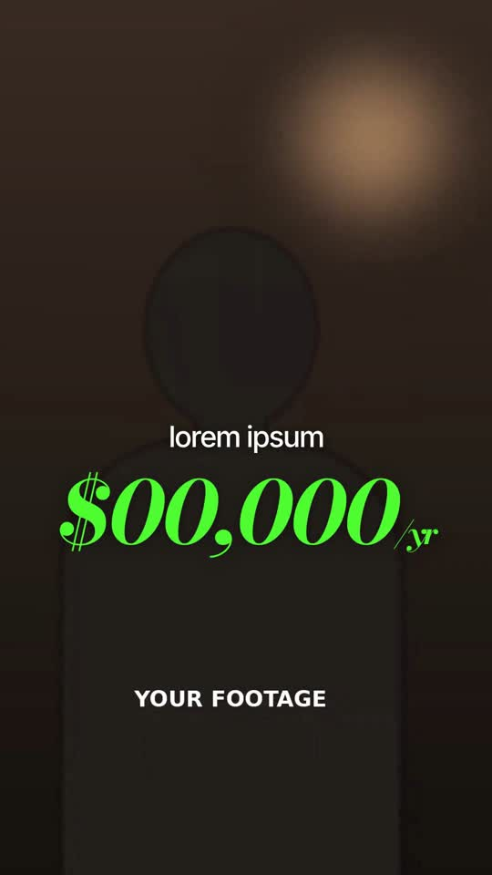

# 07 · Podcast Emphasis Captions

**Reference:** "In life the audience hears what they want to hear…" (podcast clip)
**Best for:** Podcast/interview clips, long-form repurposing, any dialogue-heavy reel.
**Format:** 1080×1920 (9:16), 30 fps · demo length 10.6 s · footage: Yes: a talking-head video plays under every scene (`footageSrc`).

  ·  [preview.mp4](preview.mp4)

## Look
- Unretouched multi-cam podcast footage.
- Plain captions: medium-weight sans, very tight tracking, white, mid-frame, 2–4 words.
- Emphasis words replace or overlap the caption in a huge italic Didone (Bodoni Moda) in loud colours: green for money, yellow for feelings, red for the punchline.
- B-roll documents: a book page with highlighter strokes and a rounded inset clip; a typewriter 'DAILY SCHEDULE' list.

## Motion language
- Captions hard-cut with the speech; no animation on plain words.
- Emphasis words stamp in (scale 1.5 → 1 in 0.18 s, slight rotation).
- Highlighter strokes sweep across quoted lines in sequence; page drifts upward.
- Typewriter rows stamp on every 75 ms, then a big caption lands over the dimmed list.

## Edit rhythm
Follows speech; an emphasis word every 1.5–3 s; one document insert every ~10 s.

## Scene recipe
All on-screen copy is lorem-ipsum placeholder sized like the reference; quotes below describe what each slot held in the reference reel. Replace it with lines from your script or the footage transcript, keeping roughly the same word count per slot.

| Scene file | What it does |
| --- | --- |
| `compositions/pc1.html` | Captions + '$48,000/yr' and 'happy…' emphasis. |
| `compositions/pc2.html` | Book page with highlights + inset card. |
| `compositions/pc3.html` | Typewriter schedule + '20 hrs/day'. |
| `compositions/pc4.html` | Punchline word 'hustle.' |

## What to swap
- Footage: `footageSrc`.
- Colours: `money`, `emotion`, `warning`, `marker`.
- Book text and schedule rows are plain HTML: edit freely.
- Editable variables (HyperFrames Variables panel): `money`, `emotion`, `warning`, `marker`.

## Build / render
```bash
cd styles/07-podcast-emphasis-captions/template
python3 ../../../tools/build_index.py .   # after reordering/retiming scenes.json
npx hyperframes preview                    # live preview / edit
npx hyperframes check                      # lint + layout audit
npx hyperframes render -o out.mp4          # final render
```
