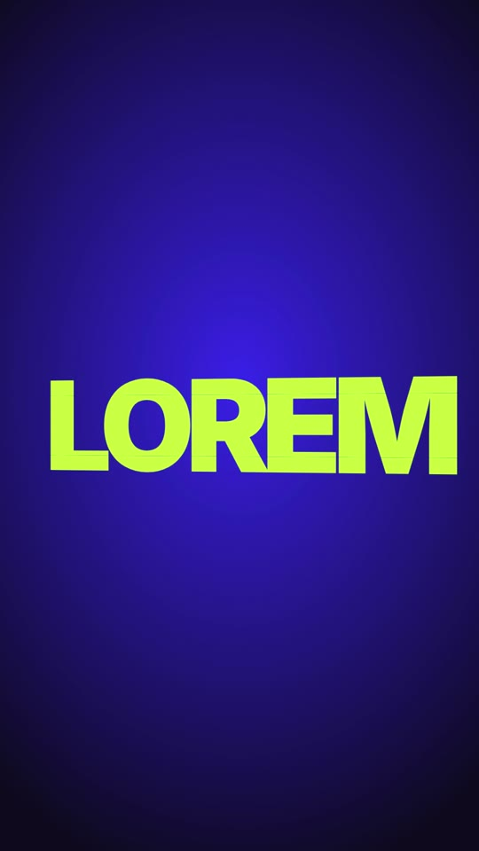

# 08 · Blinds Unfold Text

**Origin:** an original kinetic 3D text effect for this repo (not based on a reference reel).
**Best for:** Bold one-word statements and title sequences: each word is cut into horizontal slats that swing open like venetian blinds.
**Format:** 1080×1920 (9:16), 30 fps · demo length 4.1 s · footage: No (colour stage).

  ·  [preview.mp4](preview.mp4)

## Look
- Giant heavy sans word (Inter 900, 290 px) on a cobalt stage.
- The word is sliced into 6 horizontal strips; alternating hinges (top/bottom) make it fold like an accordion.
- Word colours cycle lime → white → coral.

## Motion language
- **Open:** strips swing from edge-on to flat, top to bottom, 0.05 s apart, with an overshoot.
- **Close:** strips turn edge-on again from the bottom up, then the next word opens.
- **Parallax:** the whole word turns slowly (rotationY −10° → 10°).

## Edit rhythm
~1.3 s per word including open and close.

## Scene recipe
| Scene file | What it does |
| --- | --- |
| `compositions/bf1.html` | Three words open and close as venetian blinds. |

## What to swap
- Words: the text inside each group's 6 strips (`bf1-a*`, `bf1-b*`, `bf1-c*`).
- Colours: `c1`, `c2`, `stageLight`, `stageDeep`.
- Strip count/height: regenerate with N strips of H px (word box = N × H).

## Build / render
```bash
cd styles/08-blinds-unfold-text/template
python3 ../../../tools/build_index.py .
npx hyperframes preview
npx hyperframes check
npx hyperframes render -o out.mp4
```
