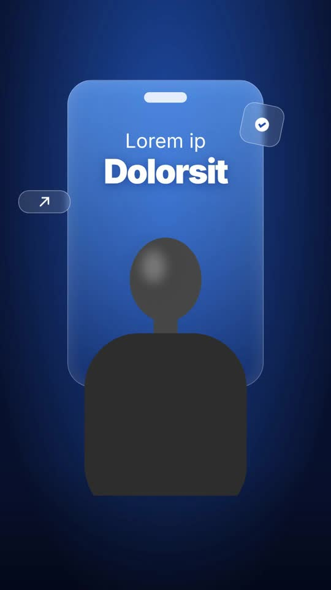

# 08 · Glass SaaS Explainer

**Reference:** "aftereffects / videoediting / motiondesign" (8 s business explainer)
**Best for:** SaaS/fintech explainers, B2B ads, founder-led product stories with a seated presenter shot on a plain backdrop.
**Format:** 1080×1920 (9:16), 30 fps · demo length 9.2 s · footage: No: pure motion graphics.

  ·  [preview.mp4](preview.mp4)

## Look
- Presenter cut-out on a deep studio-blue gradient.
- Frosted-glass phone panel behind the presenter, glass chips with arrow/check icons.
- Dark glass tile with an arrow that turns red (profit down).
- Lime scene: textured orb inside a glowing ring, task cards with High/Medium/Low tags multiplying.
- Inter for UI copy, heavy Poppins for punch words, one neon handwritten word (Caveat).

## Motion language
- Panel grows from the bottom, headline pops with `back.out`, chips float.
- Zoom-through transitions (scale 1.6 + blur).
- Arrow swings from up to down with a red glow bloom = the turn of the story.
- Task cards pop in with accelerating stagger (overwhelm).
- Thought-bubble trail pops next to the presenter.

## Edit rhythm
2 s per idea, every scene one metaphor object. Total 8–10 s per message.

## Scene recipe
All on-screen copy is lorem-ipsum placeholder sized like the reference; quotes below describe what each slot held in the reference reel. Replace it with lines from your script or the footage transcript, keeping roughly the same word count per slot.

| Scene file | What it does |
| --- | --- |
| `compositions/gs1.html` | 'You are Growing' glass panel + presenter. |
| `compositions/gs2.html` | Profit arrow tile flips to red. |
| `compositions/gs3.html` | Orb + multiplying task cards. |
| `compositions/gs4.html` | 'more operational costs' + thought bubble. |

## What to swap
- `assets/subject-cutout.png` → your presenter cut-out (remove background first).
- Orb: `object-sphere-green.png`.
- Colours: `studio`, `lime`, `alert`.
- Editable variables (HyperFrames Variables panel): `studio`, `lime`, `alert`.

## Build / render
```bash
cd styles/08-glass-saas-explainer/template
python3 ../../../tools/build_index.py .   # after reordering/retiming scenes.json
npx hyperframes preview                    # live preview / edit
npx hyperframes check                      # lint + layout audit
npx hyperframes render -o out.mp4          # final render
```
