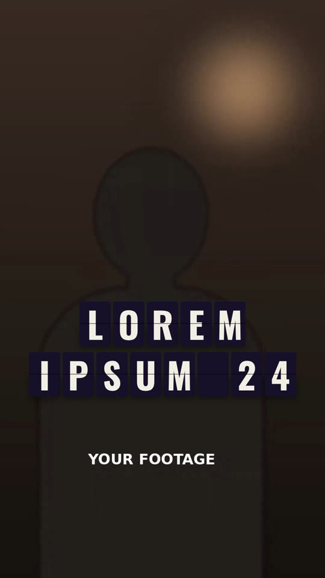

# 08 · Split-Flap Board

**Origin:** an original kinetic 3D text effect for this repo (not based on a reference reel).
**Best for:** Announcements, dates, prices, destinations: text that clatters into place on an airport departure board.
**Format:** 1080×1920 (9:16), 30 fps · demo length 3.6 s · footage: Yes: a talking-head video plays underneath (`footageSrc`).

  ·  [preview.mp4](preview.mp4)

## Look
- Dark tiles with a hinge line, cream condensed letters (Oswald 700); two rows.
- A letter flashes lime for a moment as it lands.

## Motion language
- **Flip:** each tile cycles through 6–11 random characters (seeded, so every render matches) and lands on its target; one flip every 0.07 s. Each flip is real split-flap 3D: the top flap falls, then the bottom flap lands.
- **Wave:** tiles start left to right, the second row a beat later.
- Board fades up at the start and away at the end.

## Edit rhythm
~1 s per row to settle; hold ~1.5 s.

## Scene recipe
| Scene file | What it does |
| --- | --- |
| `compositions/sf1.html` | Two rows flip through random letters into place over the footage. |

## What to swap
- Text: one `.tile` per character; set `data-target` (and the spans) to the character. A space gives a blank tile.
- Colours: `tile`, `glyph`, `hi`. Flip speed: `FLIP`; stagger: `start` in the script.

## Build / render
```bash
cd styles/08-split-flap-board/template
python3 ../../../tools/build_index.py .
npx hyperframes preview
npx hyperframes check
npx hyperframes render -o out.mp4
```
