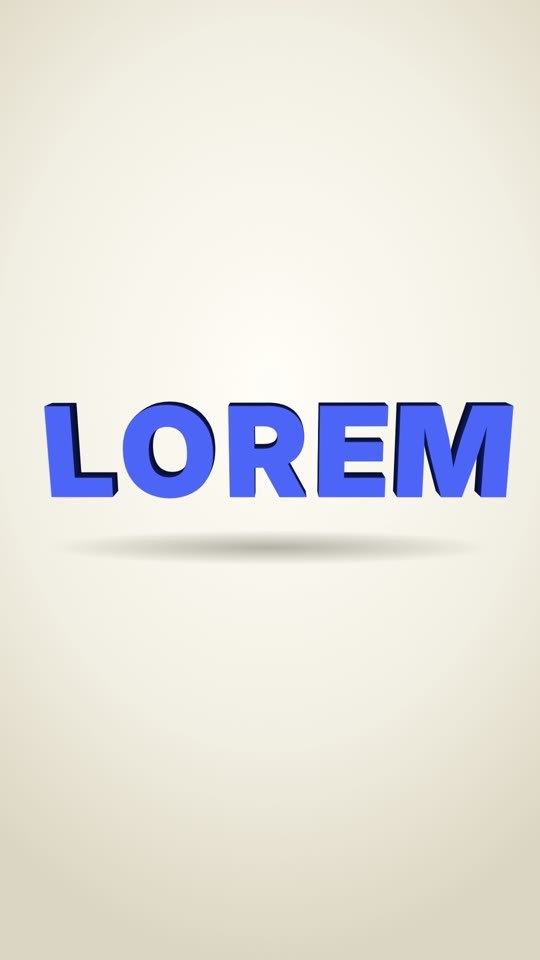

# 09 · Domino Letters

**Origin:** an original kinetic 3D text effect for this repo (not based on a reference reel).
**Best for:** Product names and one-word reveals with a physical, toy-like feel: thick 3D letters stand up like dominoes and knock each other over.
**Format:** 1080×1920 (9:16), 30 fps · demo length 3.4 s · footage: No (colour stage).

  ·  [preview.mp4](preview.mp4)

## Look
- Solid extruded letters: each glyph stacked 12 times behind its face, getting darker = a slab with real depth.
- Bright cobalt letters set tight (each slab as wide as its own glyph, 12 px apart) on a warm cream studio floor with a soft shadow; camera looks slightly down at the 'table'.

## Motion language
- **Stand up:** every letter starts lying flat toward camera and tips up on its bottom edge, left to right, with a bounce.
- **Orbit:** the camera eases around the row (rotationY 28° → −24°) so the thickness shows.
- **Topple:** a nudge on the first letter knocks the row over backwards like dominoes.

## Edit rhythm
0.11 s between letters; ~2 s hold; 0.6 s topple.

## Scene recipe
| Scene file | What it does |
| --- | --- |
| `compositions/dl1.html` | Letters stand up one by one, camera orbits, row topples. |

## What to swap
- Word: one `.L` per letter, the same letter in all 13 spans (12 `.lay` + `.face`); each `.L` width hugs its glyph (`GLYPH` widths in the generator). Spacing: `gap` on `#dl1-stage`.
- Colours: `ink` (face), `studio`; side colour in each `.lay` style (hsl).
- Depth: number of `.lay` spans and their `translateZ` step.

## Build / render
```bash
cd styles/09-domino-letters/template
python3 ../../../tools/build_index.py .
npx hyperframes preview
npx hyperframes check
npx hyperframes render -o out.mp4
```
