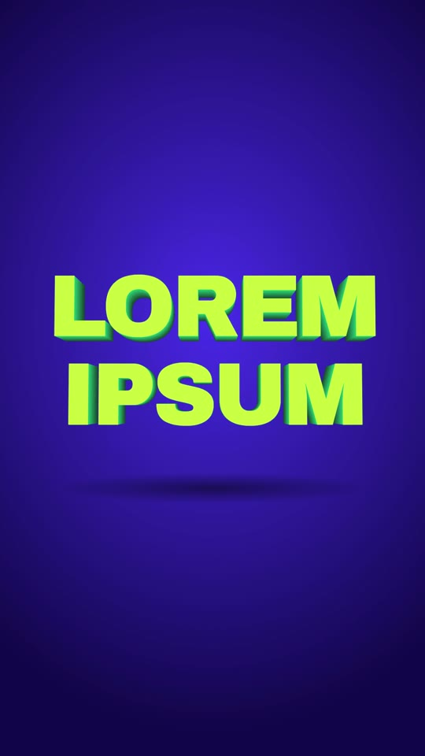

# 09 · Extruded Title Orbit

**Origin:** an original kinetic 3D text effect for this repo (not based on a reference reel).
**Best for:** Hero titles and intros: a thick 3D block-letter headline the camera orbits around before it snaps face-on.
**Format:** 1080×1920 (9:16), 30 fps · demo length 4.0 s · footage: No (colour stage).

  ·  [preview.mp4](preview.mp4)

## Look
- Two-line headline in Archivo Black; lime face with 22 extrusion layers stepping from mid to deep green = a solid block.
- Cobalt-violet stage, floor shadow, a light glare that sweeps the face.

## Motion language
- **Rise:** the block rises from the floor seen from the side.
- **Orbit:** the camera swings around it (rotationY −40° → 48°, with a tilt) so the thickness reads.
- **Snap:** it swings back to face-on with a punch-in (back.out), and the glare sweeps across.
- **Exit:** it tips back into the floor.

## Edit rhythm
0.7 s rise, 1.7 s orbit, snap + glare, ~1 s hold.

## Scene recipe
| Scene file | What it does |
| --- | --- |
| `compositions/eo1.html` | Extruded title rises, camera orbits, snaps face-on with glare, tips away. |

## What to swap
- Title: put the same text in every `.lay` and the `.face` of each `.line`.
- Colours: `c1` (face), `stageLight`, `stageDeep`; side colours in each `.lay` style.
- Depth: number of `.lay` layers and their `translateZ` step.

## Build / render
```bash
cd styles/09-extruded-title-orbit/template
python3 ../../../tools/build_index.py .
npx hyperframes preview
npx hyperframes check
npx hyperframes render -o out.mp4
```
