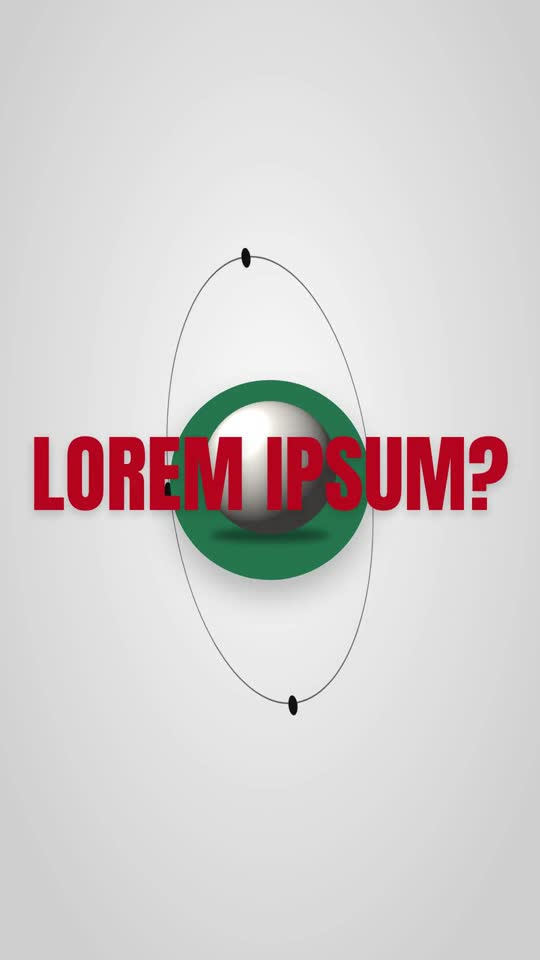

# 10 · 3D Metaphor Explainer

**Reference:** "Don't just show your brand. Make it felt." (motion-graphics reel)
**Best for:** Agency/service explainers, brand-strategy content, 'why motion design matters' style pitches.
**Format:** 1080×1920 (9:16), 30 fps · demo length 12 s · footage: No: pure motion graphics.

  ·  [preview.mp4](preview.mp4)

## Look
- Light-grey studio sweep with soft vignette; deep green `#1f6b4e` blocks and floors; red `#c3161c` condensed headlines (Anton).
- 3D objects as metaphors: brain in an orbit, retro TV, eyeball, diamond on a column, chess piece.
- Green rounded tiles with hard offset shadows (product grid).
- Dark-green neon scene with a glowing handwritten word.
- Text tricks: highlighter strike through 'Kinetic', mirrored floor reflection under 'WORD', object on a pedestal breaking the headline.

## Motion language
- Tilted orbit ring spins around the hero object.
- Tiles flip up from flat (rotationX 85 → 0) one per beat.
- Neon word flickers on; handwritten word reveals left-to-right.
- Pedestal rises through the headline; object drops onto it with `bounce.out`.

## Edit rhythm
One metaphor per 1.6–2.2 s; vertical slide or scale-down transitions.

## Scene recipe
All on-screen copy is lorem-ipsum placeholder sized like the reference; quotes below describe what each slot held in the reference reel. Replace it with lines from your script or the footage transcript, keeping roughly the same word count per slot.

| Scene file | What it does |
| --- | --- |
| `compositions/tm1.html` | EVER WONDER? orbit. |
| `compositions/tm2.html` | Brand tiles + SOME BRANDS. |
| `compositions/tm3.html` | Neon 'Magic'. |
| `compositions/tm4.html` | Kinetic Text strike. |
| `compositions/tm5.html` | WORD with reflection. |
| `compositions/tm6.html` | DECORATION on a pedestal. |

## What to swap
- `object-sphere.png` → your 3D renders (brain, TV, diamond…).
- Tile icons are placeholder SVGs; use product shots you have rights to.
- Colours: `green`, `red`, `neon`.
- Editable variables (HyperFrames Variables panel): `green`, `red`, `neon`.

## Build / render
```bash
cd styles/10-3d-metaphor-explainer/template
python3 ../../../tools/build_index.py .   # after reordering/retiming scenes.json
npx hyperframes preview                    # live preview / edit
npx hyperframes check                      # lint + layout audit
npx hyperframes render -o out.mp4          # final render
```
