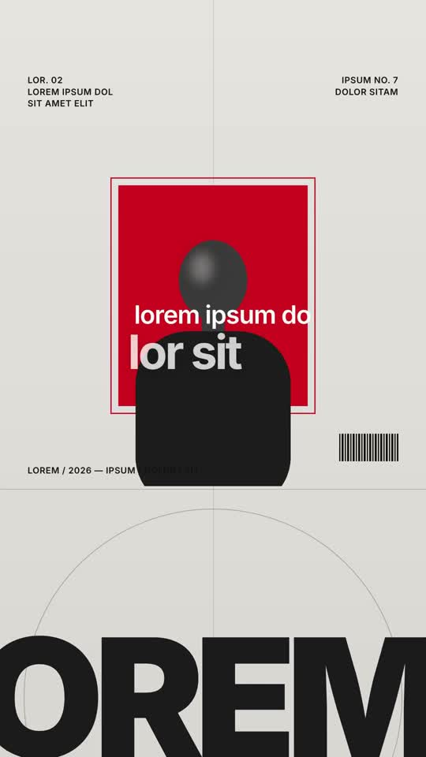

# 11 · Swiss Editorial

**Reference:** "minimalist design is one of the best ways to illustrate or convey information"
**Best for:** Thought-leadership quotes, studio showreels, design-led personal brands.
**Format:** 1080×1920 (9:16), 30 fps · demo length 9.4 s · footage: No: pure motion graphics.

  ·  [preview.mp4](preview.mp4)

## Look
- Poster grey `#d9d7d4` with visible construction lines (grid, arcs).
- Signal red block or circle as the only colour; B&W cut-out figures.
- Micro meta-text (issue numbers, captions), barcode, Fig. labels.
- Giant cropped word bleeding off the bottom; space scenes on pure black with a grey planet.
- Inter in tight tracking; hierarchy by tone (white vs dark grey) more than size.

## Motion language
- Grid lines draw in, blocks snap with `expo.out`; meta text appears in steps (no fades).
- Giant words crawl as slow marquees (two rows, opposite directions).
- Typed lines reveal in steps; camera rises out to show scale (figure on a monolith).

## Edit rhythm
Calm: 2–2.8 s per frame, motion mostly linear.

## Scene recipe
All on-screen copy is lorem-ipsum placeholder sized like the reference; quotes below describe what each slot held in the reference reel. Replace it with lines from your script or the footage transcript, keeping roughly the same word count per slot.

| Scene file | What it does |
| --- | --- |
| `compositions/sw1.html` | Poster: red block, B&W figure, meta text, 'the skills', SKILLS marquee. |
| `compositions/sw2.html` | Black space: 'it's about how you absorb'. |
| `compositions/sw3.html` | Monolith with tiny figure: 'the thing you see'. |
| `compositions/sw4.html` | Profile + 'inventing' marquees: 'in your own ideas'. |

## What to swap
- `subject-cutout.png` → your B&W cut-outs.
- Colours: `signal`, `poster`.
- Meta text is decorative: write your own issue/series labels.
- Editable variables (HyperFrames Variables panel): `signal`, `poster`.

## Build / render
```bash
cd styles/11-swiss-editorial/template
python3 ../../../tools/build_index.py .   # after reordering/retiming scenes.json
npx hyperframes preview                    # live preview / edit
npx hyperframes check                      # lint + layout audit
npx hyperframes render -o out.mp4          # final render
```
