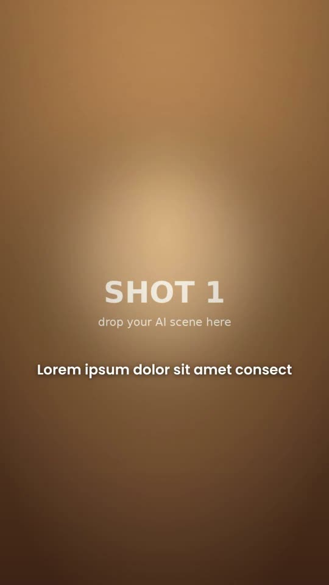

# 13 · Animated Story Ad

**Reference:** "Timeline export" — 3D-animated holiday story ad for a custom plush brand (60 s)
**Best for:** Emotional DTC story ads built from AI-generated animated shots (Pixar-like), ending in an offer card. Works for gifting, pets, family products.
**Format:** 1080×1920 (9:16), 30 fps · demo length 13 s · footage: No: pure motion graphics.

  ·  [preview.mp4](preview.mp4)

## Look
- Warm, glowing 3D-animated shots: fireplace, tree lights, golden hour.
- No on-screen text during the story (or one optional line); emotion carried by faces and props.
- End card: blurred cosy background, gold embossed offer ('$50 OFF'), hero product, CTA pill.

## Motion language
- Each shot ~1.6–2 s with a slow push-in, pull-out or pan.
- Mostly hard cuts; soft dissolves on emotional beats; warm white bloom at the turn of the story.
- End card: product rises, offer zooms in, CTA pulses.

## Edit rhythm
Shots of 1.6–2 s; story 45–55 s, end card 4–6 s.

## Scene recipe
All on-screen copy is lorem-ipsum placeholder sized like the reference; quotes below describe what each slot held in the reference reel. Replace it with lines from your script or the footage transcript, keeping roughly the same word count per slot.

| Scene file | What it does |
| --- | --- |
| `compositions/sa1.html` | Shots 1–3 (setup) with Ken Burns. |
| `compositions/sa2.html` | Shots 4–6 (turn) with bloom flash. |
| `compositions/sa3.html` | Offer end card. |

## What to swap
- `assets/shot-1..6.jpg` → your AI stills; for clips, swap `` for `<video muted playsinline>`.
- Duplicate sa1/sa2 for more shots (edit the `shots` list).
- Colours: `gold`, `cta`; brand name and offer text in `sa3.html`.
- Editable variables (HyperFrames Variables panel): `gold`, `cta`.

## Build / render
```bash
cd styles/13-animated-story-ad/template
python3 ../../../tools/build_index.py .   # after reordering/retiming scenes.json
npx hyperframes preview                    # live preview / edit
npx hyperframes check                      # lint + layout audit
npx hyperframes render -o out.mp4          # final render
```
