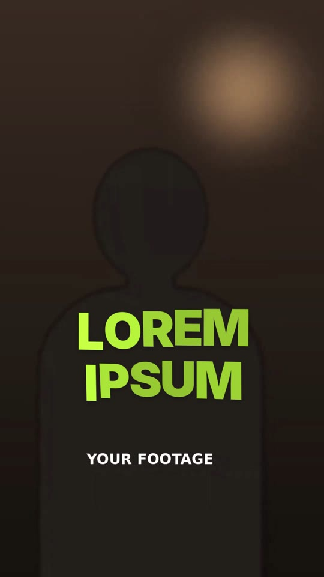

# 13 · Flag Wave Letters

**Origin:** an original kinetic 3D text effect for this repo (not based on a reference reel).
**Best for:** Energetic two-word hooks over talking heads: the letters ripple like a flag in the wind, then a gust blows them away.
**Format:** 1080×1920 (9:16), 30 fps · demo length 3.8 s · footage: Yes: a talking-head video plays underneath (`footageSrc`).

  ·  [preview.mp4](preview.mp4)

## Look
- Two rows of heavy lime letters (Inter 900) over the footage, lower-middle.
- Each letter catches the light as it turns toward camera (brightness follows the wave).

## Motion language
- **Unfurl:** letters appear left to right on a big travelling wave (tilt, depth and lift on offset sine phases).
- **Ripple:** the wave settles to a gentle flutter while the flag turns slowly (rotationY −18° → 10°).
- **Gust:** a gust tears the letters off one by one, spinning them up and out to the right.

## Edit rhythm
~0.9 s unfurl, ~2 s ripple, 0.8 s gust.

## Scene recipe
| Scene file | What it does |
| --- | --- |
| `compositions/fw1.html` | Letters unfurl, ripple like a flag, blown away by a gust. |

## What to swap
- Letters: one span per character (`fw1-c0` …, 5 per row); update `N` and the per-row maths if the rows change length.
- Colour: `c1`. Wave strength/speed: `amp`, `t * 7`, the 38/90/26 amplitudes in `wave()`.

## Build / render
```bash
cd styles/13-flag-wave-letters/template
python3 ../../../tools/build_index.py .
npx hyperframes preview
npx hyperframes check
npx hyperframes render -o out.mp4
```
