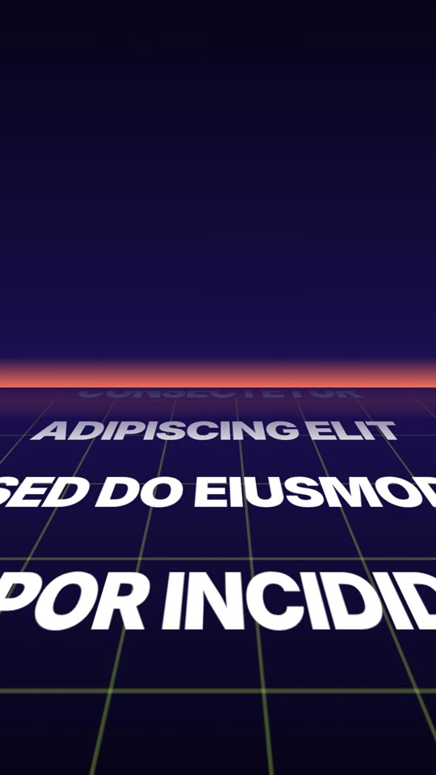

# 16 · Horizon Crawl

**Origin:** an original kinetic 3D text effect for this repo (not based on a reference reel).
**Best for:** Big intros, manifestos and 'here's what's coming' lists: lines glide away across a neon grid floor, then the key word stands up out of it.
**Format:** 1080×1920 (9:16), 30 fps · demo length 4.6 s · footage: No (colour stage).

  ·  [preview.mp4](preview.mp4)

## Look
- Night stage with a coral horizon glow and a lime grid floor tipped back 64°.
- White heavy lines (Inter 900) lying on the floor; the hero word in lime (Archivo Black).

## Motion language
- **Crawl:** the lines slide over the floor away from camera, shrinking with perspective and vanishing at the horizon, while the grid rushes underneath.
- **Stand up:** the hero word starts lying flat on the floor and pivots up on its baseline with a bounce, then slowly pushes in.
- **Exit:** it tips back and vanishes.

## Edit rhythm
~2.5 s crawl (6 lines), 0.7 s stand-up, ~1 s hold.

## Scene recipe
| Scene file | What it does |
| --- | --- |
| `compositions/hc1.html` | Lines crawl into the distance; the hero word stands up out of the floor. |

## What to swap
- Crawl lines: the `.cl` divs in `#hc1-crawl`. Hero word: `#hc1-hero`.
- Colours: `c1`, `glow`; grid colour in `#hc1-grid`.
- Speed: the `#hc1-crawl` y tween; floor angle: `rotationX: 64`.

## Build / render
```bash
cd styles/16-horizon-crawl/template
python3 ../../../tools/build_index.py .
npx hyperframes preview
npx hyperframes check
npx hyperframes render -o out.mp4
```
