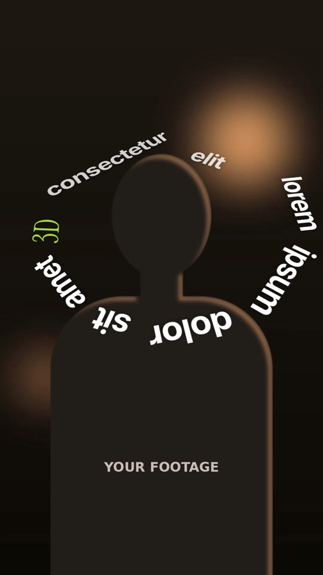

# 18 · Spiral Orbit Text

**Inspired by:** the word-spiral moment in "How to do the 3D text effect… straight sauce ep 1" (a sentence wound round the speaker's head). The spiral-around-the-subject look is borrowed; the animation is new.
**Best for:** Hook lines and questions that should wrap around the speaker: "how do you…", "the 3 things…", course and tutorial openers.
**Format:** 1080×1920 (9:16), 30 fps · demo length 6.2 s · footage: Yes (`footageSrc`) **plus a subject cut-out** (`cutoutSrc`) so the far side of the spiral passes behind the person.

  ·  [preview.mp4](preview.mp4)

## Look
- One sentence laid end to end on an inward spiral (Archimedean, radius shrinks as it winds) centred on the head, starting at about 12 o'clock and running clockwise.
- Baselines follow the curve, so the bottom of the spiral reads upside down and the sides read vertically, as in the reference.
- The spiral plane is tilted back 32° in 3D: the lower turn comes toward camera and is bigger; the upper turn goes behind the head and is smaller and dimmer.
- Medium tight sans (Inter 700, white) with one accent word in italic serif (Instrument Serif, lime).

## Motion language
- **Slide along the track:** each word glides into its slot along the spiral from 140° behind it, fading up (0.55 s, cubic out), timed to the word being spoken. It does not fly in from the camera.
- **Constant turn:** the whole spiral keeps rotating clockwise (26°/s) while it builds, with a slow breathing push-in.
- **Dive through:** to exit, the camera plunges through the centre: the spiral scales ×4.2 and twists while the turns rush outward past the lens, then blur out.

## Edit rhythm
A word every ~0.35 s (speech pace), ~1.5 s hold once complete, 1.2 s dive.

## Scene recipe
| Scene file | What it does |
| --- | --- |
| `compositions/sp1.html` | Spiral builds word by word around the head, turns, then the camera dives through it. |

## What to swap
- Words: the `sp1-b*` (back) and `sp1-f*` (front) lists, in reading order. Keep both lists identical. Use class `serif` for an accent word.
- Timing: `T_IN` (when each word starts arriving), ideally from the transcript's word timestamps.
- Shape: `R0` (outer radius), `K` (how fast it winds inward), `START` (start angle), `TILT` / `ROLL` (3D tilt), `GAP` (space between words). Centre: `.plane` `left/top`.
- Footage `footageSrc` and cut-out `cutoutSrc` (must line up with the footage; for a moving subject use an alpha video, see style 16's notes).
- Colours: `ink`, `accent`.

## Build / render
```bash
cd styles/18-spiral-orbit-text/template
python3 ../../../tools/build_index.py .
npx hyperframes preview
npx hyperframes check
npx hyperframes render -o out.mp4
```
