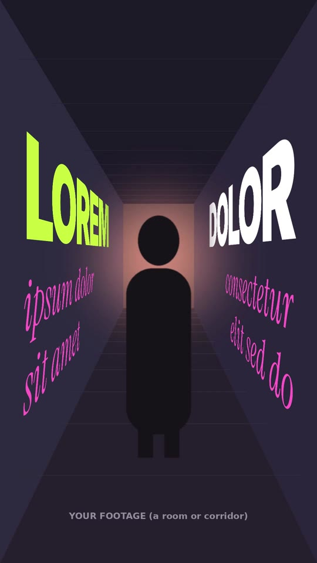

# 18 · Wall Perspective Text

**Origin:** an original kinetic 3D text effect for this repo.
**Best for:** Footage shot in a corridor, hallway, room or street with visible side walls: words "painted" on the walls, following their perspective, as if they were part of the space. Great for walk-and-talk shots and dolly moves.
**Format:** 1080×1920 (9:16), 30 fps · demo length 5 s · footage: Yes (`footageSrc`): a room or corridor with side walls.

  ·  [preview.mp4](preview.mp4)

## Look
- Text lives on the **left and right walls**, lying flat on them and receding toward the vanishing point, so the letters shrink and squash with the wall exactly like real signage would.
- A big heavy word on each wall (Inter 900, lime on the left, white on the right) with two smaller italic serif lines under it (Instrument Serif, pink).
- Text fades with distance down the corridor (depth falloff).
- The placeholder footage is a drawn corridor whose geometry matches the text exactly; replace it with your own room shot.

## Motion language
- **Arrive:** each big word glides up the corridor from the back wall to its place (left wall first, then right).
- **Paint on:** the serif lines are written along the wall in their reading direction, in steps, like hand lettering.
- **Approach:** all wall text travels toward the camera, as if the viewer is walking down the corridor, until each word is big and close at the near end of its wall. It stops just short of the frame edge, so no word is ever cropped.
- **Recede:** at the end everything slides away down the corridor and dissolves into the depth fade.

## Edit rhythm
~1 s per big word, small lines 0.5 s each, ~3.6 s approach, 0.75 s recede.

## Scene recipe
| Scene file | What it does |
| --- | --- |
| `compositions/wl1.html` | Words arrive on both walls, serif lines paint on, slow dolly, recede down the corridor. |

## Lining up a wall with your footage
The scene's camera has to match the room in your shot. In `wl1.html`:
1. `perspective-origin` on `#wl1` = the **vanishing point** of your shot (where the floor and ceiling lines meet), in px.
2. `left` of `#wl1-L` = where the **left wall** meets the frame at the near edge (x px); for the right wall, set `left` of `#wl1-R` so its right edge (left + 3000) sits where the right wall meets the frame.
3. `top` / `height` of `.wall` = the ceiling and floor lines at the near edge.
4. `perspective` (1000px) controls how fast the walls recede: raise it for a long hallway seen from far away, lower it for a short room filmed close.
If the camera moves in your shot, animate the lanes' `x` to match the walk (the DOLLY tweens) or use a locked-off shot.

## What to swap
- Words: `wl1-l1…l3` (left wall) and `wl1-r1…r3` (right wall). Long words run further down the wall, never toward the camera.
- No-crop rule: the words start 700 px down each wall (`.side-L .w` / `.side-R .w`) and the approach moves them 660 px closer, ending ~40 px from the wall's near edge. Start + approach must stay above 0 or the nearest letter leaves the frame.
- Colours: `c1`, `c2`, `c3`. Depth falloff: the `mask-image` gradients on the walls.
- Footage: `footageSrc`.

## Build / render
```bash
cd styles/18-wall-perspective-text/template
python3 ../../../tools/build_index.py .
npx hyperframes preview
npx hyperframes check
npx hyperframes render -o out.mp4
```
