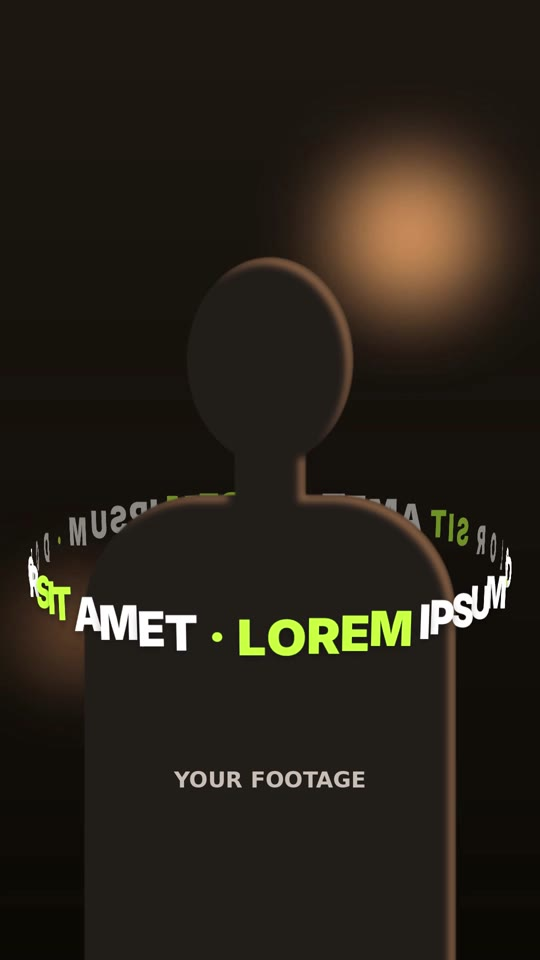

# 20 · Horizontal Orbit Text

**Origin:** an original kinetic 3D text effect for this repo.
**Best for:** A slogan, brand name or tagline orbiting the speaker like a carousel or a planet's ring: intros, "this changed everything" hooks, product names wrapped around the person.
**Format:** 1080×1920 (9:16), 30 fps · demo length 6 s · footage: Yes (`footageSrc`) **plus a subject cut-out** (`cutoutSrc`) so the back of the ring passes behind the person.

  ·  [preview.mp4](preview.mp4)

## Look
- A band of **upright, evenly spaced** letters on a horizontal circle around the body at chest height, seen from slightly above, so it reads as a clean ellipse.
- Every letter faces the camera and is narrowed as it turns toward the sides (by the cosine of its angle), so the band curves convincingly while letters never cut into each other.
- The near half passes in front of the person; the far half passes **behind** them, reversed and dimmer, exactly as lettering on a real ring would look from behind.
- Heavy sans (Inter 900, 104 px); words alternate lime and white, separators in lime. The phrase repeats to close the loop seamlessly.

## Motion language
- **Only the orbit:** the ring is already circling the body when it fades in, turns continuously (letters run across the front like a carousel), and fades out in place. The camera tilt is fixed, so it always reads as a full ellipse.

## Edit rhythm
Continuous orbit; at the default speed a letter goes round about once every 3.9 s.

## Scene recipe
| Scene file | What it does |
| --- | --- |
| `compositions/ho2.html` | Ring fades in already orbiting the body (back half behind the person), keeps turning, fades out. |

## How it differs from 19 Halo Orbit
19 is a ring of words lying **in** a tilted halo plane around the head. 33 is a **horizontal** carousel band: letters stand upright and the whole band turns on a vertical axis around the body.

## What to swap
- Phrase: `#ho2-copy` (end it with a separator like ` · `); it repeats to wrap the ring so the loop closes exactly. If the phrase must squeeze to fit, the letters shrink slightly instead of overlapping; if it has room, the gaps grow.
- Colours: `c1`, `c2`.
- Ring: `R` (radius: keep it wider than the body), the `.tilt` `rotateX` in the CSS (how far above we look from), `.tilt` `top` (height on the body). Speed: the `spin` tween (−560° over 6 s).
- Footage `footageSrc`, cut-out `cutoutSrc` (must line up with the footage; for a moving subject use an alpha video, see style 03's notes).

## Build / render
```bash
cd styles/20-horizontal-orbit-text/template
python3 ../../../tools/build_index.py .
npx hyperframes preview
npx hyperframes check
npx hyperframes render -o out.mp4
```
