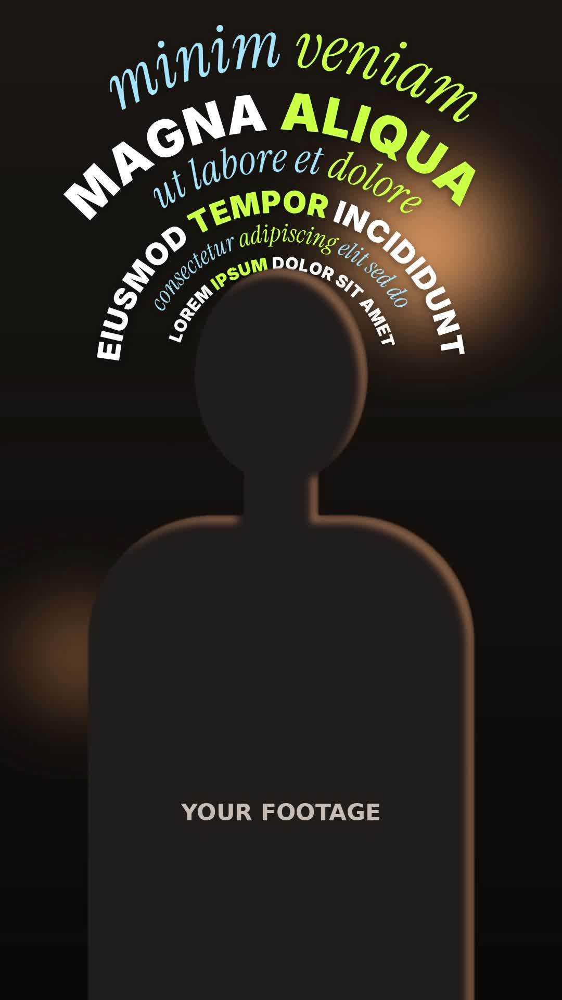

# 22 · Contour Rings Text

**Origin:** inspired by a typography motion-graphics tutorial (concentric words wrapped round a head), rebuilt with this repo's palette and its own motion.
**Best for:** Quotes, manifestos and intros over a talking head: lines of text nest round the speaker's head like contour lines, growing bigger ring by ring.
**Format:** 1080×1920 (9:16), 30 fps · demo length 6 s · footage: Yes (talking head + subject cut-out).

  ·  [preview.mp4](preview.mp4)

## Look
- Six concentric arcs of text centred on the speaker's head, reading left to right over the top. Small near the head, big on the outside.
- Rings alternate heavy Inter caps (white) and Instrument Serif italic (sky). Each ring has one lime accent word.
- The subject cut-out sits over the rings, so the words hug the head tightly.

## Motion language
- **Build:** rings appear from the inside out, one every 0.42 s. In each ring a wave runs left to right: every letter swings in along the arc from further out and smaller, then settles on its baseline.
- **Breathe:** once built, the rings sway gently, neighbouring rings in opposite directions.
- **Unwind:** the rings leave from the outside in. Letters keep travelling clockwise along their arc, drift outward and fade.

## Edit rhythm
0.15–3.1 s build (6 rings), ~1.4 s hold, 4.55–5.9 s unwind.

## Scene recipe
| Scene file | What it does |
| --- | --- |
| `compositions/cr1.html` | Concentric rings of words build round the head, sway, unwind. |

## What to swap
- Lines: the `<p>` list in `#cr1-copy`, innermost first. `data-font` = `sans` / `serif`, `data-size` = font size. Wrap the accent word in `<b>`. Long lines shrink to fit their arc; if the stack gets too tall for the frame, every ring scales down together.
- Head position: `.rings` `left` / `top` in the CSS (head centre) and `R0` (first ring radius, just outside the head). Match these to your footage.
- Footage and cut-out: `footageSrc`, `cutoutSrc` (a transparent PNG of the speaker).
- Timing: `BUILD0`, `BUILD_STEP`, `BUILD_DUR`, `EXIT0`, `EXIT_STEP`, `EXIT_DUR`.
- Colours: `c1` (sans rings), `c2` (accent words), `c3` (serif rings).

## How it works
Each ring has a baseline radius. Letters are measured, laid end to end along the arc and centred on straight up: a letter at arc distance `s` sits at angle `θ = s / r`, placed with `rotate(θ) translate(0, −r)`. The next ring starts just outside this ring's letter tops. One time proxy drives a deterministic renderer that computes each letter's build, sway and unwind from the time.

## Build / render
```bash
cd styles/22-contour-rings-text/template
python3 ../../../tools/build_index.py .
npx hyperframes check
npx hyperframes render -o out.mp4
```
