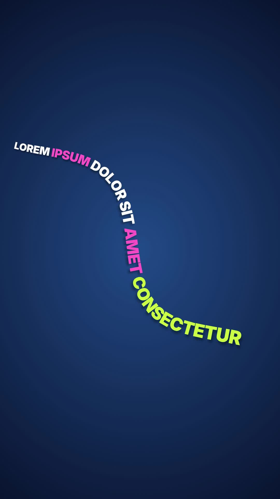

# 24 · Snake Text

**Origin:** an original kinetic text effect for this repo.
**Best for:** One punchy sentence that needs movement and energy: the words slither diagonally across the screen in the shape of a snake, with the last word as its head.
**Format:** 1080×1920 (9:16), 30 fps · demo length 6 s · footage: No (colour stage).

  ·  [preview.mp4](preview.mp4)

## Look
- One sentence laid letter by letter along a sine wave that runs diagonally from the top-left to the bottom-right of a deep blue stage.
- The body tapers like a snake: the tail letters are half size, the letters grow toward the head, and the last word (the head) is lime and biggest. Every third word is pink, the rest white.
- Each letter turns with the curve and casts a soft drop shadow.

## Motion language
- **Slither in:** the head enters top-left and the body follows along the path, decelerating as the whole sentence comes on screen.
- **Crawl:** the snake creeps slowly forward while the wave itself undulates, so the body keeps wriggling. The whole sentence stays readable on screen.
- **Slither out:** it speeds up and exits bottom-right, tail last.

## Edit rhythm
1.8 s enter, 2.4 s readable crawl, 1.8 s exit.

## Scene recipe
| Scene file | What it does |
| --- | --- |
| `compositions/sn1.html` | Sentence slithers in along a diagonal sine path, crawls, slithers out. |

## What to swap
- Sentence: `#sn1-copy`. The last word becomes the head. Long sentences shrink automatically so the whole snake fits on screen during the crawl.
- Path: `A` / `B` (start and end of the diagonal), `AMP` (wave height), `WAVE` (wavelength).
- Taper: `scaleAt` (tail size 0.5 → head 1.0).
- Colours: `c1` (head), `c2` (body), `c3` (accent words), `stageLight`, `stageDeep`.

## How it works
The path is sampled into a table of points with cumulative arc length. The snake is a list of letters, each at a fixed distance behind the head. Every frame, the head distance `s` is advanced and each letter is placed at its own point on the path, rotated to the path heading and scaled by its taper. A second tween moves the sine phase, so the curve itself wriggles.

## Build / render
```bash
cd styles/24-snake-text/template
python3 ../../../tools/build_index.py .
npx hyperframes check
npx hyperframes render -o out.mp4
```
