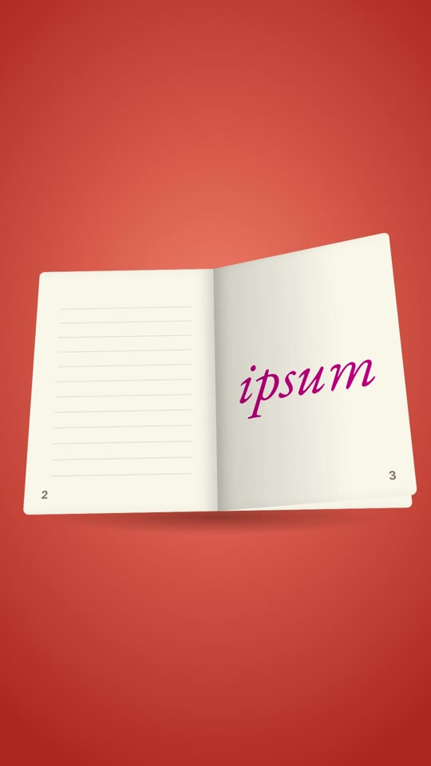

# 25 · Page Flip Words

**Origin:** an original kinetic 3D text effect for this repo (not based on a reference reel).
**Best for:** Storytelling and list intros with a tactile, editorial feel: one word per page of an open book, pages turning on the spine.
**Format:** 1080×1920 (9:16), 30 fps · demo length 4.4 s · footage: No (colour stage).

  ·  [preview.mp4](preview.mp4)

## Look
- An open book seen from slightly above on a coral stage; cream pages with ruled lines and page numbers.
- One word per right-hand page: heavy sans (Archivo Black, cobalt) or italic serif (EB Garamond, magenta).

## Motion language
- **Open:** the book swings up from a steep angle into view.
- **Turn:** each page lifts and turns 180° on the spine (ease in to 90°, ease out to the left), darkening as it lifts; the face swaps exactly at 90° so nothing flickers.
- **Tilt:** the book slowly tilts toward camera while pages turn; it drops away at the end.

## Edit rhythm
A page every ~0.85 s; 4 pages.

## Scene recipe
| Scene file | What it does |
| --- | --- |
| `compositions/pf1.html` | Book opens, three pages turn, book drops away. |

## What to swap
- Words: one per page `pf1-p0` … `pf1-p3` (class `sans` or `serif`).
- Colours: `ink`, `accent`, `stageLight`, `stageDeep`.
- Turn times: the `flip(i, t)` calls; add pages by copying a `.page` (lower z-index each).

## Build / render
```bash
cd styles/25-page-flip-words/template
python3 ../../../tools/build_index.py .
npx hyperframes preview
npx hyperframes check
npx hyperframes render -o out.mp4
```
