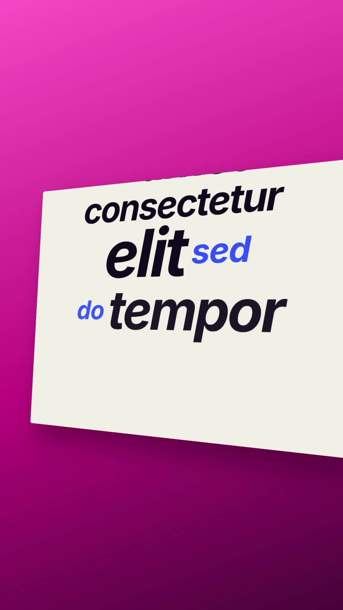

# 26 · Wall Projection Words

**Origin:** inspired by a kinetic typography tutorial (words on a white wall), rebuilt with this repo's palette and its own motion.
**Best for:** Quotes and voice-over lines: words slam onto a tilted wall one beat at a time.
**Format:** 1080×1920 (9:16), 30 fps · demo length 6.3 s · footage: No (colour stage).

  ·  [preview.mp4](preview.mp4)

## Look
A cream wall tilted in 3D on a pink-magenta stage; each beat is a big black italic word with a small cobalt partner word.

## Motion language
Each new line flips up from flat at the bottom of the wall with a squash on landing and pushes the stack up; old lines leave over the top edge. The wall slowly turns; at the end all lines fly off.

## Scene recipe
| Scene file | What it does |
| --- | --- |
| `compositions/s29.html` | Quotes and voice-over lines. |

## What to swap
Lines: the `.ln` blocks (`data-size` per line; `.a` big word, `.b` accent word). Beat: `STEP`.

## Build / render
```bash
cd styles/26-wall-projection-words/template
python3 ../../../tools/build_index.py .
npx hyperframes check
npx hyperframes render -o out.mp4
```
