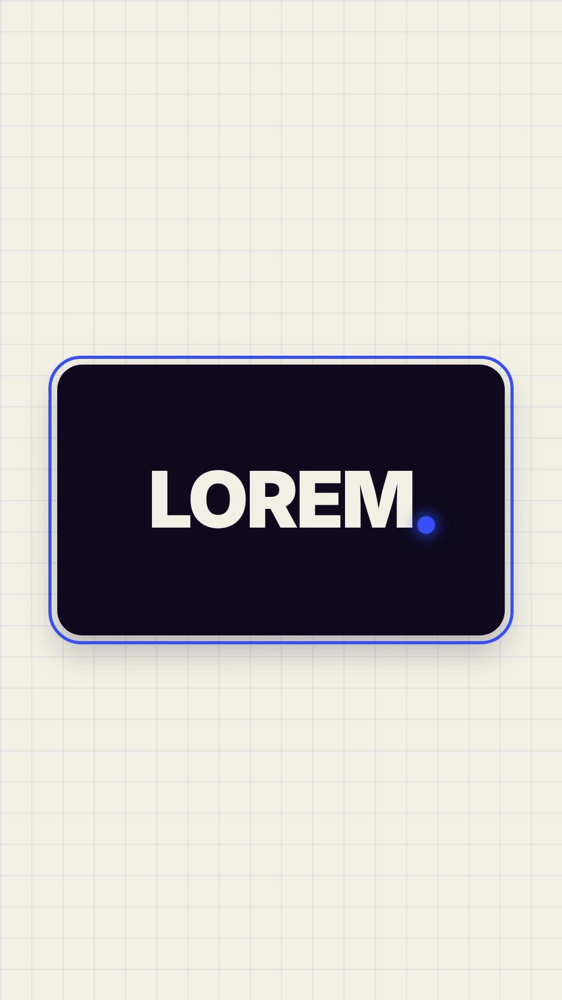

# 28 · Boxed Dot Stop

**Origin:** inspired by a boxed text motion-graphics tutorial, rebuilt with this repo's palette and its own motion.
**Best for:** Short names and one-word hooks in a card: a glowing dot draws the frame, then becomes the full stop the word slides out of.
**Format:** 1080×1920 (9:16), 30 fps · demo length 6 s · footage: No (colour stage).

  ·  [preview.mp4](preview.mp4)

## Look
A dark navy card with a cobalt frame on cream grid paper; the word is cream; the dot glows cobalt.

## Motion language
The dot traces the card's frame, flies to the end of the word's position and pulses; the word slides out of it to the left; then the word slides back in, the dot moves on to the next word, and finally drops away as the frame retracts.

## Scene recipe
| Scene file | What it does |
| --- | --- |
| `compositions/s33.html` | Short names and one-word hooks in a card. |

## What to swap
Words: the `.wd` blocks.

## Build / render
```bash
cd styles/28-boxed-dot-stop/template
python3 ../../../tools/build_index.py .
npx hyperframes check
npx hyperframes render -o out.mp4
```
