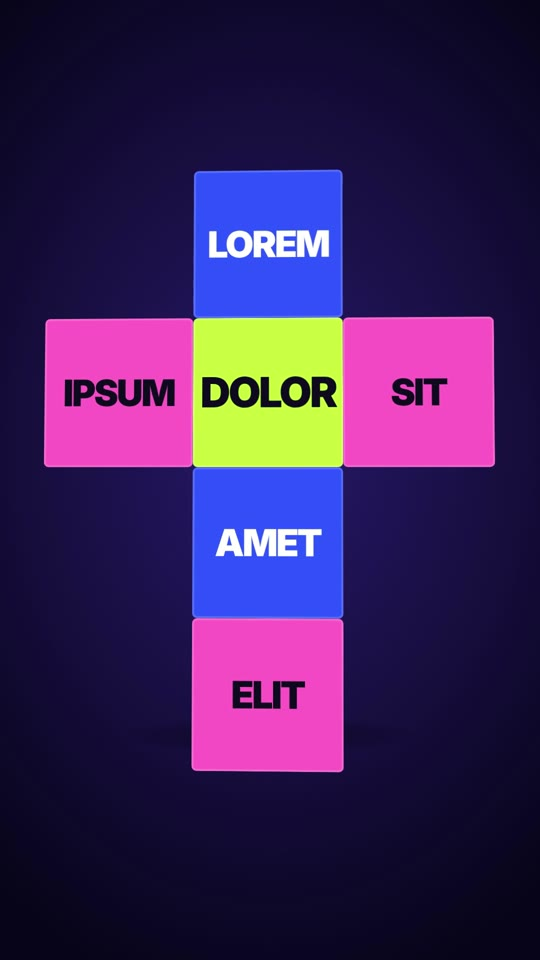

# 28 · Cube Unfold Text

**Origin:** an original kinetic 3D text effect for this repo (replaces the earlier Coin Flip Letters).
**Best for:** Six-part messages that should feel like one object: product features, a 6-step list, "what's inside", brand values. The closed cube teases the words, then it unfolds flat so every one reads at once.
**Format:** 1080×1920 (9:16), 30 fps · demo length 4.6 s · footage: No (colour stage).

  ·  [preview.mp4](preview.mp4)

## Look
- A solid cube with one word on each face: the centre face lime, the others alternating cobalt and pink (Inter 900).
- Unfolded, the faces form a cross (the classic cube net): TOP / LEFT · FRONT · RIGHT / BOTTOM / BACK.
- Indigo stage with a soft floor shadow.

## Motion language
- **Drop + spin:** the closed cube falls in tumbling and turns so several faces show.
- **Unfold:** it squares up to the camera and the hinges open one after another (sides, top, bottom, then the back, which rides on the bottom face) with a springy overshoot, lifting slightly as it flattens.
- **Float:** the flat cross tilts gently so it still reads as paper-thin 3D.
- **Refold + exit:** it snaps shut and spins up out of frame.

## Edit rhythm
~1.8 s closed (spin), ~0.8 s unfold, ~1 s hold, ~0.9 s refold and exit.

## Scene recipe
| Scene file | What it does |
| --- | --- |
| `compositions/cu1.html` | Cube drops in, spins, unfolds into a cross of 6 words, refolds and spins away. |

## What to swap
- Words: one per face inside each `.skin` (`cu1-front` is the centre; `cu1-back` hangs off `cu1-bottom`).
- Colours: `c1` (centre face), `c2` (faces A), `c3` (faces B), `stageLight`, `stageDeep`.
- Size: face size is 300 px (width/height of `.f`, offsets of ±300 px and the `-150px` spin origin all change together).
- Timing: the hinge tweens in the UNFOLD block; the hold length is the gap before REFOLD.

## How it works
The cube is built as a net: each face is a child of the face it is hinged to, rotating around their shared edge. Folded, every hinge sits at 90°; unfolded, every hinge is at 0°.

## Build / render
```bash
cd styles/28-cube-unfold-text/template
python3 ../../../tools/build_index.py .
npx hyperframes preview
npx hyperframes check
npx hyperframes render -o out.mp4
```
