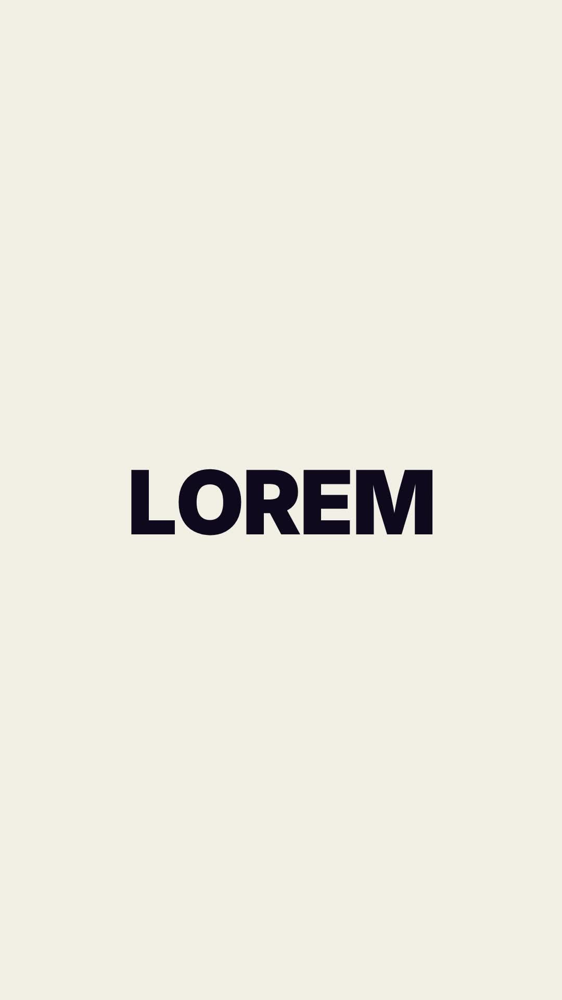

# 30 · Rail Shot Letters

**Origin:** inspired by a text slide animation tutorial, rebuilt with this repo's palette and its own motion.
**Best for:** Brand words and short names: letters shoot along vertical rails into line, leaving coloured speed bars.
**Format:** 1080×1920 (9:16), 30 fps · demo length 6 s · footage: No (colour stage).

  ·  [preview.mp4](preview.mp4)

## Look
Navy heavy letters on cream; each letter's speed bar is cobalt, coral, pink or lime.

## Motion language
Each letter waits at a random height, then shoots along its rail into line with a coloured bar stretched behind it; the word holds, then letters shoot off along their rails as the next word arrives.

## Scene recipe
| Scene file | What it does |
| --- | --- |
| `compositions/s36.html` | Brand words and short names. |

## What to swap
Words: the `.w` blocks. Bar colours: `COLS`.

## Build / render
```bash
cd styles/30-rail-shot-letters/template
python3 ../../../tools/build_index.py .
npx hyperframes check
npx hyperframes render -o out.mp4
```
