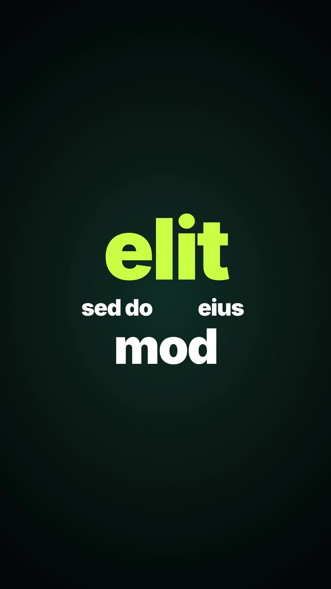

# 30 · Zoom-Through Clusters

**Origin:** inspired by a kinetic typography tutorial (dark word clusters), rebuilt with this repo's palette and its own motion.
**Best for:** Fast-paced statements: clusters of mixed-size words, and the camera dives into one word to reach the next cluster.
**Format:** 1080×1920 (9:16), 30 fps · demo length 6 s · footage: No (colour stage).

  ·  [preview.mp4](preview.mp4)

## Look
White and lime heavy type on a deep green-black stage, arranged as small clusters of mixed sizes.

## Motion language
Each cluster pops in word by word; then the camera dives into one tiny word, which becomes the big word of the next cluster, with a blur on the dive.

## Scene recipe
| Scene file | What it does |
| --- | --- |
| `compositions/s30.html` | Fast-paced statements. |

## What to swap
Clusters: the `.cl` blocks (`data-x`, `data-y`, `data-s` per word; `data-target` = the word to dive into).

## Build / render
```bash
cd styles/30-zoom-through-clusters/template
python3 ../../../tools/build_index.py .
npx hyperframes check
npx hyperframes render -o out.mp4
```
