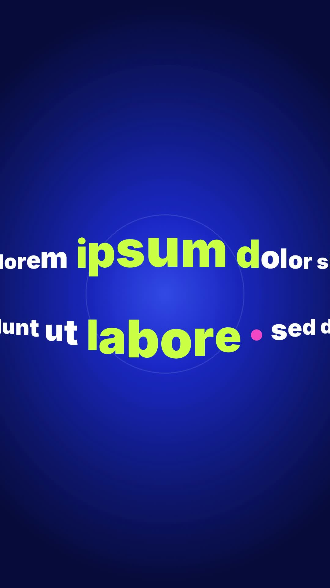

# 31 · Fisheye Lens Stream

**Origin:** inspired by a viral fish-eye text tutorial, rebuilt with this repo's palette and its own motion.
**Best for:** Taglines and lists: two lines stream through a glass-ball lens that magnifies the letters passing the centre.
**Format:** 1080×1920 (9:16), 30 fps · demo length 6 s · footage: No (colour stage).

  ·  [preview.mp4](preview.mp4)

## Look
White heavy type on a cobalt stage; letters inside the lens turn lime; a faint lens ring sits in the centre.

## Motion language
Two lines scroll in opposite directions; near the centre each letter is magnified and the line is stretched (position = integral of the magnification), so neighbours are pushed apart and the rows bulge apart.

## Scene recipe
| Scene file | What it does |
| --- | --- |
| `compositions/s31.html` | Taglines and lists. |

## What to swap
Lines: the two `.row` texts (`data-dir`). Lens strength `A`, size `SIG`, `SPEED`.

## Build / render
```bash
cd styles/31-fisheye-lens-stream/template
python3 ../../../tools/build_index.py .
npx hyperframes check
npx hyperframes render -o out.mp4
```
