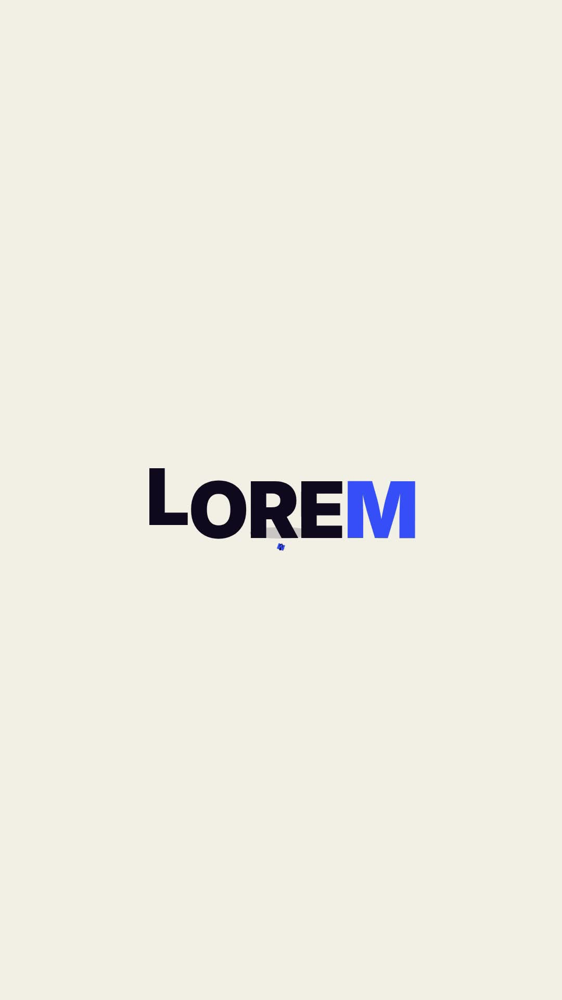

# 32 · Ball Burst Letters

**Origin:** inspired by a ball text animation tutorial, rebuilt with this repo's palette and its own motion.
**Best for:** Playful product names: a bouncing ball bursts into the word, then swallows it again.
**Format:** 1080×1920 (9:16), 30 fps · demo length 6 s · footage: No (colour stage).

  ·  [preview.mp4](preview.mp4)

## Look
Navy heavy letters (last letter cobalt) on cream, a cobalt ball with a soft floor shadow.

## Motion language
The ball drops and bounces; on the big bounce it squashes and bursts into letters that spring out with spin. Letters hop in a wave, get sucked back into the ball, and the ball rolls off and back with the next word.

## Scene recipe
| Scene file | What it does |
| --- | --- |
| `compositions/s32.html` | Playful product names. |

## What to swap
Words: the `.word` blocks. Cycle length `CYC`.

## Build / render
```bash
cd styles/32-ball-burst-letters/template
python3 ../../../tools/build_index.py .
npx hyperframes check
npx hyperframes render -o out.mp4
```
