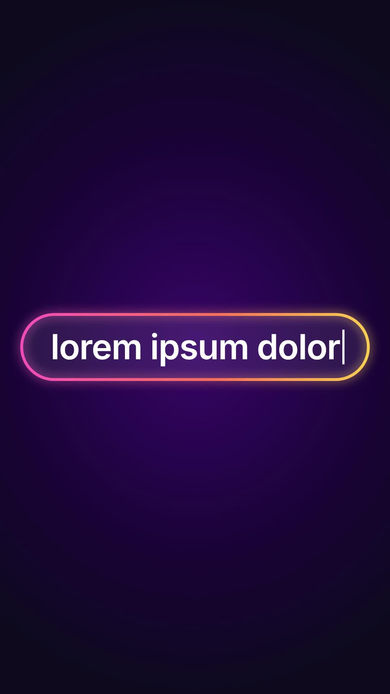

# 34 · Glow Search Bar

**Origin:** inspired by a gradient search-box typing tutorial, rebuilt with this repo's palette and its own motion.
**Best for:** Questions and search-style hooks: a glowing pill grows into a search bar and the query types itself.
**Format:** 1080×1920 (9:16), 30 fps · demo length 6 s · footage: No (colour stage).

  ·  [preview.mp4](preview.mp4)

## Look
A pink-coral-yellow gradient pill with a soft glow on a deep violet stage; white text with a caret.

## Motion language
The pill pops from a dot and stretches into a full bar; the query types with a caret; the bar shrinks into a compact search field as a magnifier slides in, then the bar sweeps off.

## Scene recipe
| Scene file | What it does |
| --- | --- |
| `compositions/s34.html` | Questions and search-style hooks. |

## What to swap
Query: `#s34-q`. Colours `c1`–`c3` (gradient).

## Build / render
```bash
cd styles/34-glow-search-bar/template
python3 ../../../tools/build_index.py .
npx hyperframes check
npx hyperframes render -o out.mp4
```
