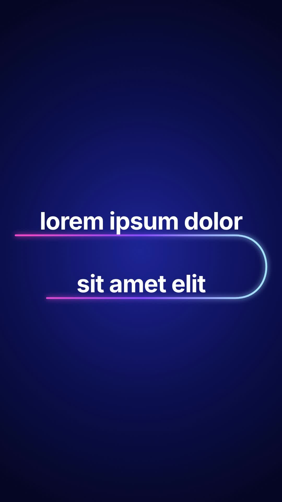

# 35 · Comet Rail Reveal

**Origin:** inspired by a gradient light-streak text tutorial, rebuilt with this repo's palette and its own motion.
**Best for:** Two-line statements: a comet streaks under each line and reveals it, leaving a glowing rail.
**Format:** 1080×1920 (9:16), 30 fps · demo length 6 s · footage: No (colour stage).

  ·  [preview.mp4](preview.mp4)

## Look
White text on a night-blue stage; the comet is a white-hot core with a warm halo; the rail is a pink-violet-sky gradient with glow.

## Motion language
The comet follows an S-route: under line 1 left to right (revealing it), a U-turn, then under line 2 right to left. The rail retracts and the lines lift out.

## Scene recipe
| Scene file | What it does |
| --- | --- |
| `compositions/s35.html` | Two-line statements. |

## What to swap
Lines: `#s35-l1`, `#s35-l2`. Route: `#s35-path`.

## Build / render
```bash
cd styles/35-comet-rail-reveal/template
python3 ../../../tools/build_index.py .
npx hyperframes check
npx hyperframes render -o out.mp4
```
