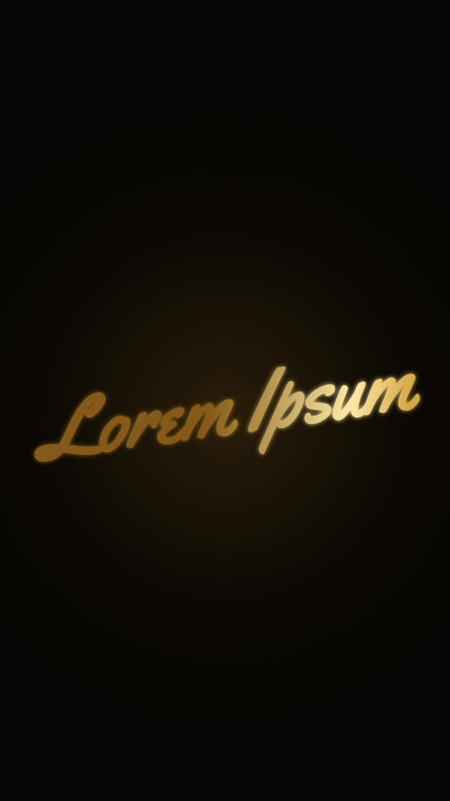

# 36 · Golden Signature

**Origin:** inspired by a cinematic script-title text tutorial, rebuilt with this repo's palette and its own motion.
**Best for:** Elegant names and signatures: gold script writes itself behind a glowing spark.
**Format:** 1080×1920 (9:16), 30 fps · demo length 6 s · footage: No (colour stage).

  ·  [preview.mp4](preview.mp4)

## Look
Yellowtail script in a gold gradient with glow on a warm black stage.

## Motion language
A glowing spark traces the outline and sheds embers; the gold fill pours in; a glint sweeps across the lettering; then it fades.

## Scene recipe
| Scene file | What it does |
| --- | --- |
| `compositions/s44.html` | Elegant names and signatures. |

## What to swap
Text: the two `<text>` elements. Draw time: `DUR`.

## Build / render
```bash
cd styles/36-golden-signature/template
python3 ../../../tools/build_index.py .
npx hyperframes check
npx hyperframes render -o out.mp4
```
