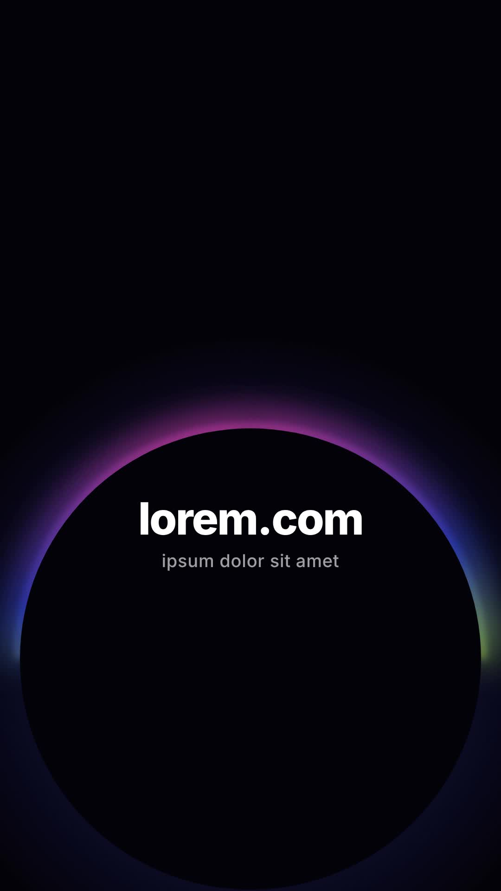

# 37 · Horizon Arc Glow

**Origin:** inspired by a gradient arc (planet horizon) text tutorial, rebuilt with this repo's palette and its own motion.
**Best for:** Brand reveals: a glowing gradient horizon rises and the name fades up under it.
**Format:** 1080×1920 (9:16), 30 fps · demo length 6 s · footage: No (colour stage).

  ·  [preview.mp4](preview.mp4)

## Look
A pink-cobalt-lime gradient arc with bloom over black, white name and grey tagline.

## Motion language
The arc draws out from its top in both directions while it rises into frame; its colours drift round the rim; the name and tagline fade up; then everything sets.

## Scene recipe
| Scene file | What it does |
| --- | --- |
| `compositions/s45.html` | Brand reveals. |

## What to swap
Name: `.t1`, tagline: `.t2`. Colours `c1`–`c3`.

## Build / render
```bash
cd styles/37-horizon-arc-glow/template
python3 ../../../tools/build_index.py .
npx hyperframes check
npx hyperframes render -o out.mp4
```
