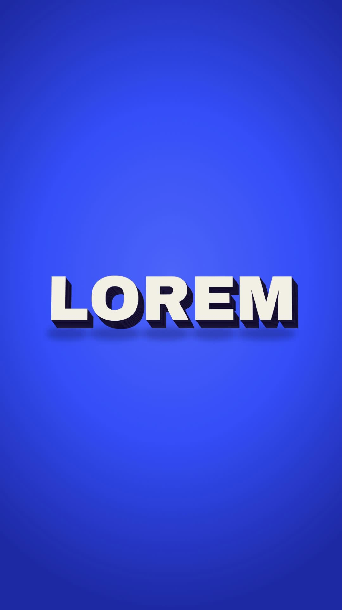

# 37 · Key Hop Extrude

**Origin:** inspired by a 3D text pop-up tutorial, rebuilt with this repo's palette and its own motion.
**Best for:** Bold one-word titles: chunky extruded letters stand up and hop like piano keys.
**Format:** 1080×1920 (9:16), 30 fps · demo length 6 s · footage: No (colour stage).

  ·  [preview.mp4](preview.mp4)

## Look
Cream letters with a stepped navy 3D side (16 layers) on a cobalt stage; the last letter is lime; soft floor shadows.

## Motion language
Letters stand up from flat one by one, then hop in two waves (squash on landing, shadows shrink as they rise), and finally fall flat.

## Scene recipe
| Scene file | What it does |
| --- | --- |
| `compositions/s37.html` | Bold one-word titles. |

## What to swap
Word: `TXT` in the script. Depth: `DEPTH`.

## Build / render
```bash
cd styles/37-key-hop-extrude/template
python3 ../../../tools/build_index.py .
npx hyperframes check
npx hyperframes render -o out.mp4
```
