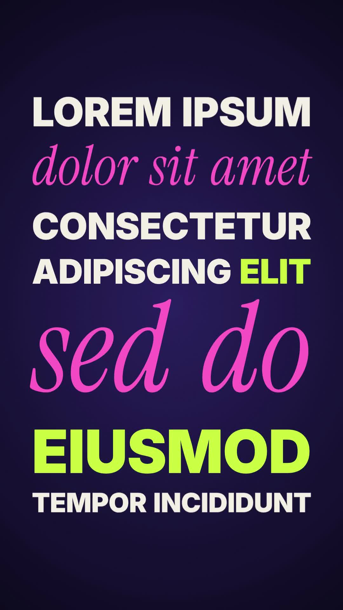

# 39 · Camera Lockup Type

**Origin:** inspired by a typography motion-graphics tutorial (words flipping in to build a stacked lockup), rebuilt with this repo's palette and a moving camera.
**Best for:** Hooks, titles and short statements: words fly in one by one and lock into a tight, justified block of mixed sizes, with a camera that frames each word as it lands.
**Format:** 1080×1920 (9:16), 30 fps · demo length 6 s · footage: No (colour stage).

  ·  [preview.mp4](preview.mp4)

## Look
- A stacked typographic lockup: every row is justified to the same width, so short rows come out huge and long rows small.
- Heavy Inter caps in cream, Instrument Serif italic rows in pink, accent words in lime, on a deep violet stage.

## Motion language
- **Assemble:** words arrive in reading order, one every 0.25 s, each with one of four entrances in turn: a flip down from above, a 3D swing in from the right, a 90° spin in from the left, a rise toward the camera. Each has motion blur and a small overshoot.
- **Camera:** the camera starts close on the first word and re-frames as each word lands, pulling back a little further every time, until the whole block is on screen. When the zoomed block is wider than the frame, the camera stays inside it, so it never shows a ragged half-row.
- **Exit:** a slow push-in while the rows flip up and away, top row first.

## Edit rhythm
0.3–3.85 s assemble (13 words), camera settles at ≈4.4 s, hold, 5.0–5.9 s exit.

## Scene recipe
| Scene file | What it does |
| --- | --- |
| `compositions/lk1.html` | Words fly in and lock into a justified block while the camera re-frames, then the rows flip away. |

## What to swap
- Text: the `<p>` rows in `#lk1-copy` (one per row, top to bottom). `data-font` = `sans` / `serif`; wrap accent words in `<b>`. Fewer words per row = bigger row.
- Block width: `BW0`. If the block is taller than `MAXH`, the width shrinks to fit.
- Timing: `FIRST`, `STEP` (gap between words), `FLY` (entrance length), `EXIT`. Keep the last word landing before about 4 s in a 6 s scene.
- Camera: closeness of the early close-ups in `zWord` (in `build()`).
- Colours: `c1` (sans), `c2` (accent), `c3` (serif), `stageLight`, `stageDeep`.

## How it works
Each row is measured at 100 px and given the font size that makes it exactly the block width. Rows are packed by cap height, not line box, so the block stays tight. The camera is a list of keys (one per word, plus the full block) interpolated with an ease in/out and applied as one `translate · scale · translate` on the block wrapper. Each word's entrance is computed from the time in one deterministic renderer.

## Build / render
```bash
cd styles/39-camera-lockup-type/template
python3 ../../../tools/build_index.py .
npx hyperframes check
npx hyperframes render -o out.mp4
```
