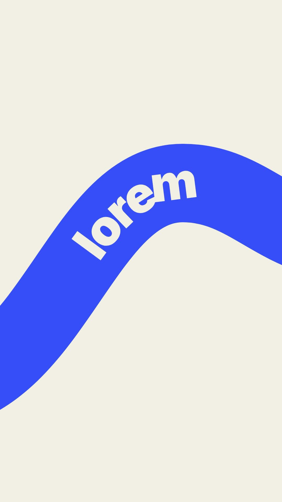

# 39 · Ribbon Ride Words

**Origin:** inspired by a line text animation tutorial, rebuilt with this repo's palette and its own motion.
**Best for:** Sequences of three words: fat ribbons sweep across on an S-curve and each word rides its ribbon.
**Format:** 1080×1920 (9:16), 30 fps · demo length 6 s · footage: No (colour stage).

  ·  [preview.mp4](preview.mp4)

## Look
Cobalt, lime and pink ribbons on cream; heavy type riding the curve.

## Motion language
Each ribbon sweeps in and its word slides along it, bending with the band; ribbons stack over each other, then peel away to a small title.

## Scene recipe
| Scene file | What it does |
| --- | --- |
| `compositions/s48.html` | Sequences of three words. |

## What to swap
Words: `#s48-copy` (`data-b` band, `data-t` text). Curve: `#s48-p`.

## Build / render
```bash
cd styles/39-ribbon-ride-words/template
python3 ../../../tools/build_index.py .
npx hyperframes check
npx hyperframes render -o out.mp4
```
