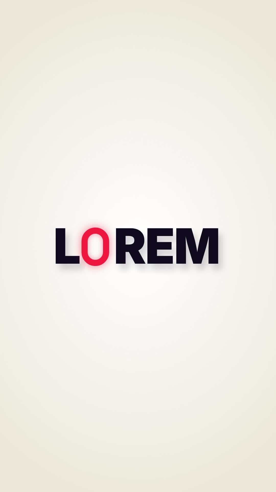

# 40 · Neon Capsule Word

**Origin:** inspired by a minimal text animation tutorial (red capsule), rebuilt with this repo's palette and its own motion.
**Best for:** Logos and names with an O: a red neon capsule tumbles in and becomes one letter, the rest of the word shoves out of it.
**Format:** 1080×1920 (9:16), 30 fps · demo length 6 s · footage: No (colour stage).

  ·  [preview.mp4](preview.mp4)

## Look
Heavy navy letters with long soft shadows on warm white; one letter is a glowing red capsule.

## Motion language
The capsule tumbles in spinning, lands at its letter, and the other letters shove out of it both ways with blur and skew; it spins once mid-hold; then everything slides back and the capsule flies off.

## Scene recipe
| Scene file | What it does |
| --- | --- |
| `compositions/s40.html` | Logos and names with an O. |

## What to swap
Word: `data-word`; which letter is the capsule: `data-cap`.

## Build / render
```bash
cd styles/40-neon-capsule-word/template
python3 ../../../tools/build_index.py .
npx hyperframes check
npx hyperframes render -o out.mp4
```
