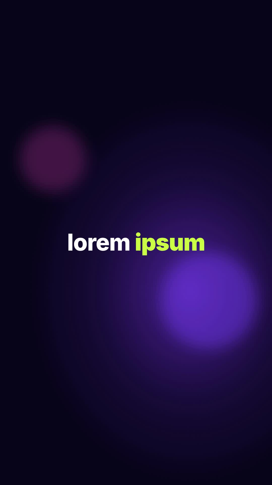

# 40 · Shard Punch Zoom

**Origin:** inspired by a text pop-up animation tutorial, rebuilt with this repo's palette and its own motion.
**Best for:** Clean titles with punch: a white shard slices across and the camera punches into an extreme close-up.
**Format:** 1080×1920 (9:16), 30 fps · demo length 6 s · footage: No (colour stage).

  ·  [preview.mp4](preview.mp4)

## Look
Small white titles (accent word lime) on a deep violet bokeh stage.

## Motion language
Each line settles in; a white shard slices across; the camera cuts to a huge close-up drifting across the letters, then snaps back to the next line.

## Scene recipe
| Scene file | What it does |
| --- | --- |
| `compositions/s49.html` | Clean titles with punch. |

## What to swap
Lines: the `.tx` blocks. Beat: `BEAT`.

## Build / render
```bash
cd styles/40-shard-punch-zoom/template
python3 ../../../tools/build_index.py .
npx hyperframes check
npx hyperframes render -o out.mp4
```
