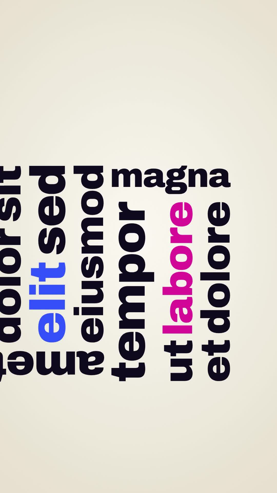

# 40 · Turning Camera Type

**Origin:** inspired by a typography motion-graphics tutorial (a word puzzle built while the camera turns), rebuilt with this repo's palette, font and layout engine.
**Best for:** Hooks and statements that should feel crafted: words slide in one by one and lock into a flush typographic puzzle, some rows level, some words on their side, while the camera turns 90° to read each sideways word.
**Format:** 1080×1920 (9:16), 30 fps · demo length 7.5 s · footage: No (colour stage).

  ·  [preview.mp4](preview.mp4)

## Look
- A tight block of lowercase heavy type (Archivo Black) in navy on a warm cream stage, with cobalt and pink accent words.
- Every row is justified to the full width of its column. Some words stand on their side next to a column of rows and grow to exactly its height. All edges are flush, like a puzzle.
- Words are packed by their actual letter shapes (ink bounds), not their line boxes, so the block is very tight.

## Motion language
- **Assemble:** words arrive in reading order, alternating between a blurred slide along their reading line and a drop in from above with a small overshoot.
- **Turning camera:** the camera frames each word as it lands and rotates so that word reads level. A sideways word turns the whole lockup 90°, holds, then turns back for the next row. Each frame is a little wider than the last.
- **Settle:** the camera pulls back to the whole block, resting at a slight −4° tilt.
- **Exit:** the camera keeps turning and pushes in while every word shoots off forward along its own reading line with motion blur.

## Edit rhythm
0.3 s first word, then 0.3 s per word (0.95 s for a sideways word), full block at ≈5.4 s, hold, 6.45–7.4 s exit.

## Scene recipe
| Scene file | What it does |
| --- | --- |
| `compositions/tc1.html` | Words assemble into a flush puzzle lockup while the camera turns to read each one, then fly off. |

## What to swap
- Text: the nested blocks in `#tc1-copy`.
  - `<p>`: a justified row.
  - `<div class="row"><i>word</i><div class="col">…</div></div>`: a sideways word next to a column. Put `<i>` first for the left (reads upward) or last for the right (reads downward).
  - `<b>` marks an accent word; `<b class="acc2">` marks the second accent.
  - Short sideways words (3–5 letters) next to 2–3 rows come out biggest.
- Block size: `BW0` (width), `MAXH` (the block shrinks if taller). Spacing: `GAP` (between blocks), `WGAP` (between words).
- Timing: `FIRST`, `STEP`, `SIDE` (hold for sideways words), `FLY`, `EXIT`. Change the scene length in `scenes.json` and the `t` tween together.
- Colours: `c1` (words), `c2` (accent), `c3` (second accent), `stageLight`, `stageDeep`.

## How it works
Each word's ink box is measured with canvas `measureText` at 100 px. A row gets the font size that makes its ink width equal the column width. A side-word row is solved by iteration: its thickness sets the column width, the column width sets the column height, and the column height sets the word size. Words are placed with their ink centre as the rotation origin. The camera is a list of keys (centre, zoom, rotation = −word angle) interpolated with an ease in/out and applied as `translate · rotate · scale · translate` on the block wrapper.

## Build / render
```bash
cd styles/40-turning-camera-type/template
python3 ../../../tools/build_index.py .
npx hyperframes check
npx hyperframes render -o out.mp4
```
