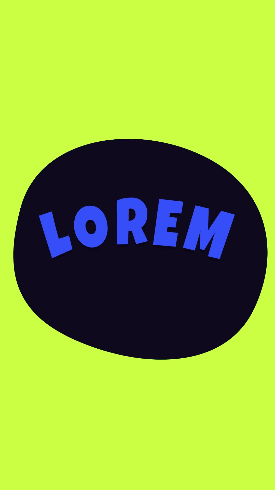

# 41 · Sticker Lyric Beats

**Origin:** inspired by a colorful lyrics typography tutorial, rebuilt with this repo's palette and its own motion.
**Best for:** Lyric videos and punchy lists: one word per beat with a new colour and a big graphic shape.
**Format:** 1080×1920 (9:16), 30 fps · demo length 6 s · footage: No (colour stage).

  ·  [preview.mp4](preview.mp4)

## Look
Each beat: a flat colour, a starburst / blob / spark shape and Luckiest Guy letters on an arc.

## Motion language
Hard cut per beat; the shape spins in; letters pop onto the arc one by one, then squash-wobble on the beat.

## Scene recipe
| Scene file | What it does |
| --- | --- |
| `compositions/s41.html` | Lyric videos and punchy lists. |

## What to swap
Beats: the `.bt` blocks (`data-bg`, `data-shape`, `data-sc`, `data-tc`). Beat length: `BEAT`.

## Build / render
```bash
cd styles/41-sticker-lyric-beats/template
python3 ../../../tools/build_index.py .
npx hyperframes check
npx hyperframes render -o out.mp4
```
