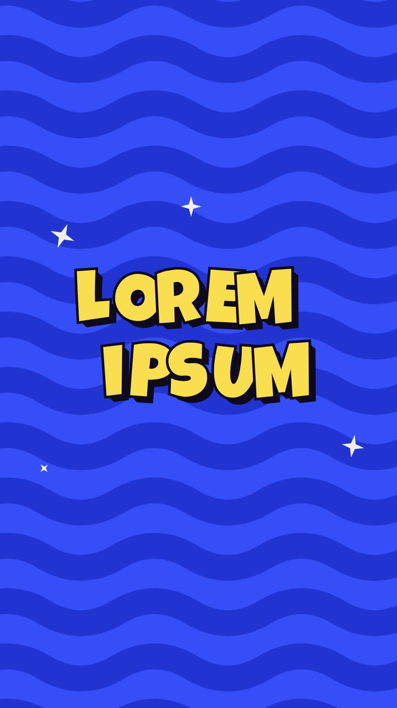

# 46 · Retro Sticker Bounce

**Origin:** inspired by a 3D retro text tutorial, rebuilt with this repo's palette and its own motion.
**Best for:** Bold titles and show names: yellow sticker letters with a thick outline bounce in over a wavy pop-art pattern.
**Format:** 1080×1920 (9:16), 30 fps · demo length 6 s · footage: No (colour stage).

  ·  [preview.mp4](preview.mp4)

## Look
Luckiest Guy yellow letters, thick navy outline and a stepped drop, on cobalt with darker waves and cream sparkles.

## Motion language
Letters spring in on elastic bounces, hop in a ripple, sparkles twinkle, and finally the letters fall away.

## Scene recipe
| Scene file | What it does |
| --- | --- |
| `compositions/s46.html` | Bold titles and show names. |

## What to swap
Lines: the `.ln` blocks. Colours `c1` (letters), `c2` (stage).

## Build / render
```bash
cd styles/46-retro-sticker-bounce/template
python3 ../../../tools/build_index.py .
npx hyperframes check
npx hyperframes render -o out.mp4
```
