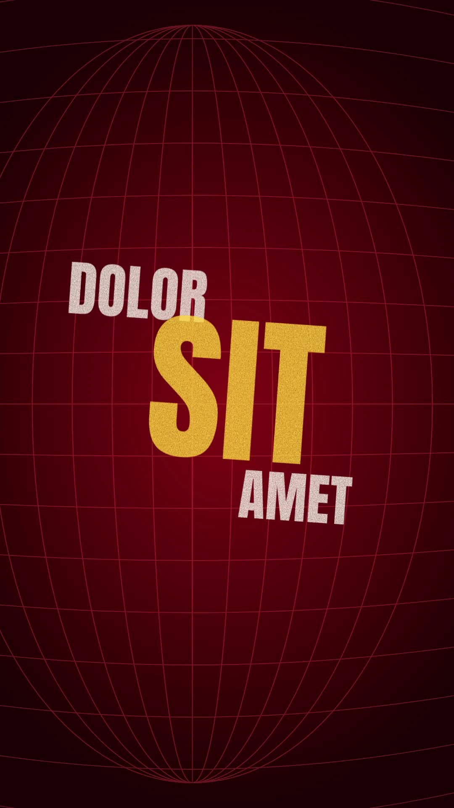

# 47 · Grunge Poster Beats

**Origin:** inspired by a typography poster edit, rebuilt with this repo's palette and its own motion.
**Best for:** Lyrics and hype lines: distressed condensed words slam in at a tilt over a red globe grid.
**Format:** 1080×1920 (9:16), 30 fps · demo length 6 s · footage: No (colour stage).

  ·  [preview.mp4](preview.mp4)

## Look
Distressed Anton words in white and yellow on a deep red stage with a curved red grid.

## Motion language
On each beat a group slams in from different sides with 3D swing, a hard settle and a shake; a whip pan carries to the next group.

## Scene recipe
| Scene file | What it does |
| --- | --- |
| `compositions/s47.html` | Lyrics and hype lines. |

## What to swap
Groups: the `.grp` blocks (`data-x`, `data-y`, `data-s`, `data-r`). Beat: `BEAT`.

## Build / render
```bash
cd styles/47-grunge-poster-beats/template
python3 ../../../tools/build_index.py .
npx hyperframes check
npx hyperframes render -o out.mp4
```
