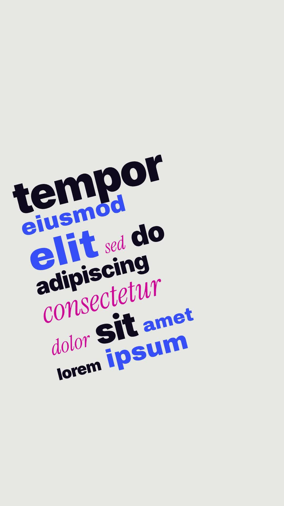

# 50 · Slanted Word Pile

**Origin:** inspired by a kinetic typography tutorial (word pile), rebuilt with this repo's palette and its own motion.
**Best for:** Long lists and statements: words in mixed fonts drop in and stack into a slanted wall of type.
**Format:** 1080×1920 (9:16), 30 fps · demo length 6 s · footage: No (colour stage).

  ·  [preview.mp4](preview.mp4)

## Look
Heavy navy, wide cobalt and pink serif-italic words on light grey, all on a -14° slant.

## Motion language
Words drop in one at a time with a little spin and stack into rows that build upward; the camera rises with the pile, then pulls back to see it whole.

## Scene recipe
| Scene file | What it does |
| --- | --- |
| `compositions/s50.html` | Long lists and statements. |

## What to swap
Words: `#s50-copy` (`data-f` font 1-3, `data-s` size).

## Build / render
```bash
cd styles/50-slanted-word-pile/template
python3 ../../../tools/build_index.py .
npx hyperframes check
npx hyperframes render -o out.mp4
```
